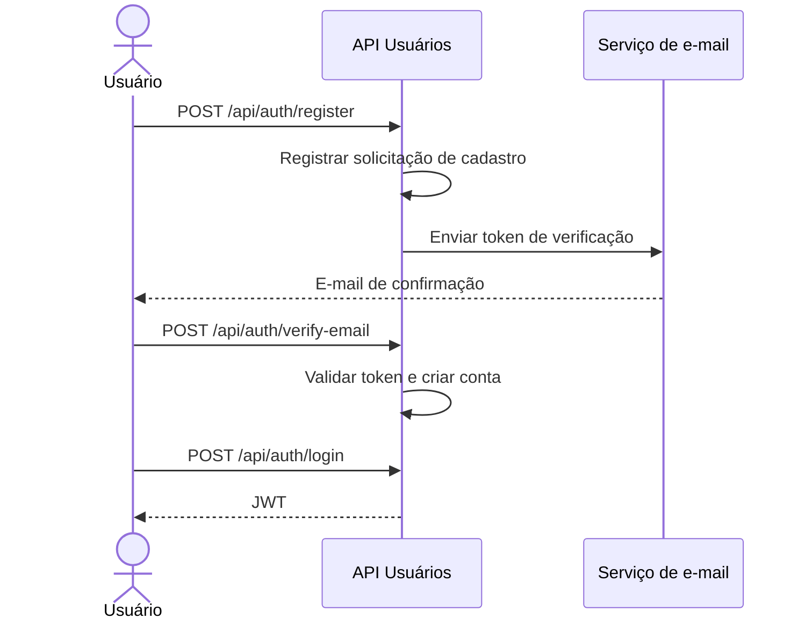
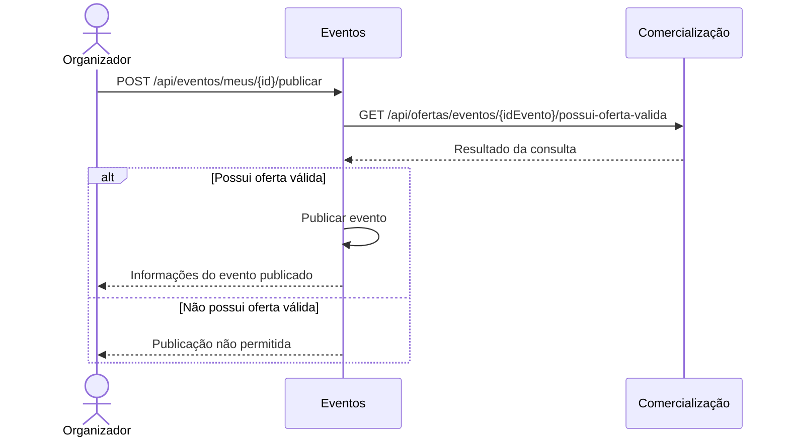
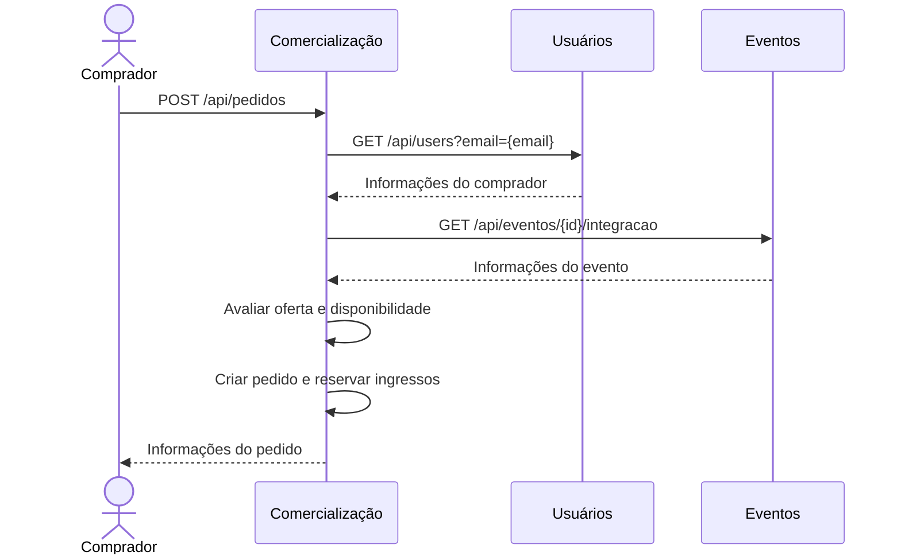
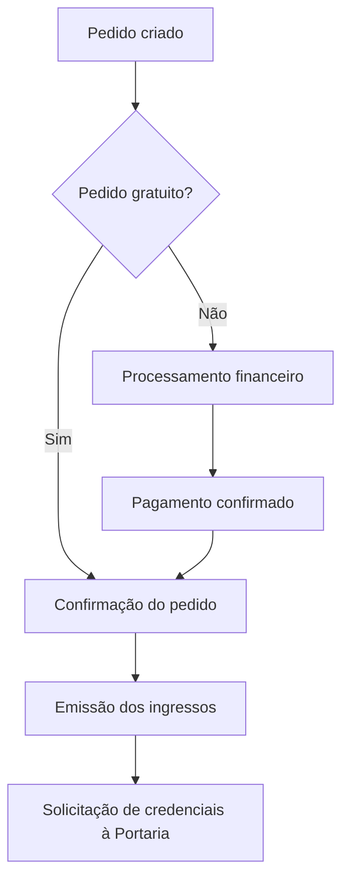
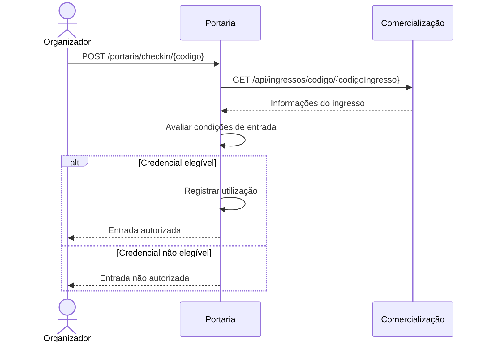
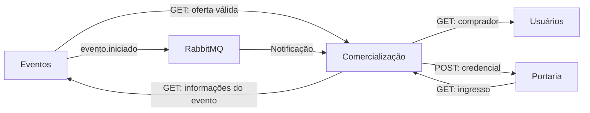

# Documentação das APIs REST

## 1. Introdução

Este documento apresenta as operações HTTP disponibilizadas pelos quatro microsserviços do sistema de gerenciamento de eventos presenciais e comercialização de ingressos digitais.

Seu objetivo é estabelecer a rastreabilidade entre as operações das APIs REST, os requisitos funcionais e as regras de negócio do sistema.

Os contratos técnicos, incluindo parâmetros, corpos de requisição e esquemas de dados, estão disponíveis nas especificações OpenAPI e nas interfaces interativas do Scalar.

Para informações complementares, consulte:

- [Requisitos de Software](RequisitosSoftware.md)
- [Regras de Negócio](RegrasNegocio.md)
- [Arquitetura](Arquitetura.md)
- [Modelagem](Modelagem.md)

## 2. Endereços das APIs

| Microsserviço | Ambiente local | Sandbox pública | OpenAPI |
|---|---|---|---|
| Usuários | http://localhost:5296 | [Scalar](https://microsservicos-eventos-presenciais.onrender.com/scalar/) | [JSON](https://microsservicos-eventos-presenciais.onrender.com/openapi/v1.json) |
| Eventos | http://localhost:5297 | [Scalar](https://microsservicos-eventos-presenciais-hctr.onrender.com/scalar/) | [JSON](https://microsservicos-eventos-presenciais-hctr.onrender.com/openapi/v1.json) |
| Comercialização | http://localhost:5298 | [Scalar](https://comercializacao.onrender.com/scalar/) | [JSON](https://comercializacao.onrender.com/openapi/v1.json) |
| Portaria | http://localhost:5299 | [Scalar](https://portaria-gdve.onrender.com/scalar/) | [JSON](https://portaria-gdve.onrender.com/openapi/v1.json) |

As URIs apresentadas neste documento são relativas ao endereço base do respectivo microsserviço.

## 3. Convenções

### 3.1. Métodos HTTP

| Método | Finalidade |
|---|---|
| `GET` | Consulta de recursos e informações. |
| `POST` | Criação de recursos ou execução de operações de negócio. |
| `PUT` | Atualização de um recurso identificado. |
| `PATCH` | Atualização de informações de um recurso existente. |

### 3.2. Autenticação

O sistema utiliza JWT para autenticação de usuários e API Key para autenticação das chamadas internas selecionadas entre microsserviços.

#### JWT Bearer

```http
Authorization: Bearer SEU_TOKEN_JWT
```

Os tokens são emitidos pelo microsserviço Usuários e validados pelos demais serviços utilizando a chave pública RSA correspondente.

#### API Key

```http
X-API-Key: SUA_CHAVE_INTERNA
```

A API Key é utilizada nas integrações internas que exigem autenticação entre microsserviços.

#### Webhooks

As notificações de pagamento recebidas da Stripe utilizam um mecanismo próprio de autenticação baseado na assinatura da requisição.

As limitações de autorização das operações relacionadas a pedidos e ingressos estão descritas na seção de escopo do [README](../README.md).

### 3.3. Rastreabilidade

As tabelas relacionam cada operação aos requisitos funcionais e às regras de negócio dos quais participa.

Uma operação pode:

- Atender diretamente a um requisito funcional.
- Fornecer informações necessárias à execução de outro requisito.
- Aplicar ou preservar uma regra de negócio.
- Participar de um fluxo distribuído envolvendo outros microsserviços.

A associação de uma regra a uma operação não significa necessariamente que sua validação seja realizada exclusivamente naquele endpoint.

O símbolo `—` indica que não existe uma regra ou requisito diretamente associado à operação no catálogo atual.

## 4. Microsserviço Usuários

Responsável pelo cadastro de usuários, gerenciamento de contas de acesso, autenticação e fornecimento de informações cadastrais aos demais microsserviços.

### 4.1. Autenticação e gerenciamento de contas

| Método | URI | Descrição | Requisitos | Regras de negócio |
|---|---|---|---|---|
| `POST` | `/api/auth/register` | Solicitar a criação de uma conta de acesso e iniciar a verificação do endereço de e-mail. | RF-13 | RN-13, RN-14, RN-15, RN-16 |
| `POST` | `/api/auth/verify-email` | Validar o token de verificação e concluir o processo de criação da conta. | RF-13 | RN-14, RN-15, RN-16 |
| `POST` | `/api/auth/login` | Autenticar um usuário com conta de acesso e emitir um JWT. | RF-14 | — |

#### Fluxo de criação de conta



A criação de uma conta de acesso depende da verificação do endereço de e-mail, conforme estabelecido na RN-15.

### 4.2. Gerenciamento cadastral

| Método | URI | Descrição | Requisitos | Regras de negócio |
|---|---|---|---|---|
| `GET` | `/api/users/me` | Consultar os dados cadastrais do usuário autenticado. | RF-15 | RN-17 |
| `PATCH` | `/api/users/me` | Atualizar o nome e o telefone do usuário autenticado. | RF-15 | RN-17 |
| `POST` | `/api/users` | Cadastrar um usuário sem exigir a criação de uma conta de acesso. | RF-22 | RN-13, RN-16 |
| `GET` | `/api/users/{id}` | Consultar um usuário por seu identificador. | Operação auxiliar de integração | — |
| `PUT` | `/api/users/{id}` | Atualizar os dados cadastrais de um usuário identificado. | Operação auxiliar de gerenciamento cadastral | RN-16 |
| `GET` | `/api/users?email={email}` | Consultar um usuário pelo endereço de e-mail informado. | Apoio ao RF-07 e RF-12 | RN-16, RN-30 |

A consulta por e-mail é utilizada pelo microsserviço Comercialização durante a criação de pedidos.

Um comprador não precisa possuir uma conta de acesso, mas deve estar previamente cadastrado no sistema.

## 5. Microsserviço Eventos

Responsável pelo cadastro, atualização, publicação e consulta de eventos presenciais.

### 5.1. Gerenciamento de eventos

| Método | URI | Descrição | Requisitos | Regras de negócio |
|---|---|---|---|---|
| `POST` | `/api/eventos` | Cadastrar um evento associado ao organizador. | RF-01, RF-16 | RN-10 |
| `PATCH` | `/api/eventos/meus/{id}` | Atualizar as informações de um evento sob responsabilidade do organizador. | RF-02 | RN-02, RN-11 |
| `GET` | `/api/eventos/meus` | Listar os eventos do organizador, com ordenação e filtragem pelo estado de publicação. | RF-21 | RN-12 |
| `GET` | `/api/eventos/meus/{id}` | Consultar individualmente um evento sob responsabilidade do organizador. | RF-21 | RN-12 |
| `POST` | `/api/eventos/meus/{id}/publicar` | Publicar um evento previamente cadastrado e disponibilizar seu endereço eletrônico público. | RF-03, RF-04 | RN-01, RN-02, RN-18 |

A operação de listagem dos próprios eventos disponibiliza os seguintes parâmetros de consulta:

| Parâmetro | Finalidade |
|---|---|
| `ordem` | Definir a ordenação dos resultados, com valor padrão `asc`. |
| `publicado` | Filtrar os eventos conforme seu estado de publicação. |

### 5.2. Consulta pública de eventos

| Método | URI | Descrição | Requisitos | Regras de negócio |
|---|---|---|---|---|
| `GET` | `/api/eventos/publicados` | Listar os eventos publicados. | RF-23 | RN-18 |
| `GET` | `/api/eventos/publicados/{id}` | Consultar um evento publicado por seu identificador. | RF-23 | RN-18 |
| `GET` | `/api/eventos/publicado/{slug}` | Consultar um evento por seu identificador público. | RF-23 | RN-18 |

Somente eventos publicados podem ter suas informações disponibilizadas para consulta pública.

### 5.3. Integração com outros microsserviços

| Método | URI | Descrição | Requisitos apoiados | Regras de negócio apoiadas |
|---|---|---|---|---|
| `GET` | `/api/eventos/{id}/integracao` | Disponibilizar informações do evento, incluindo organizador, estado temporal, estado de publicação e período de realização. | RF-05, RF-06, RF-07, RF-24 | RN-07, RN-19, RN-27, RN-29 |

A operação é utilizada por Comercialização para obter as informações necessárias à avaliação das condições de criação, atualização e consulta de ofertas e pedidos.

### 5.4. Fluxo de publicação

A publicação de um evento depende da existência de pelo menos uma oferta de ingresso válida.



**Requisitos relacionados:** RF-03 e RF-04.

**Regras relacionadas:** RN-01, RN-02 e RN-18.

## 6. Microsserviço Comercialização

Responsável pelo gerenciamento de ofertas de ingressos, pedidos, pagamentos e emissão de ingressos digitais.

### 6.1. Gerenciamento de ofertas

| Método | URI | Descrição | Requisitos | Regras de negócio |
|---|---|---|---|---|
| `POST` | `/api/ofertas` | Criar uma oferta de ingressos associada a um evento. | RF-05 | RN-03, RN-19, RN-20, RN-21, RN-27 |
| `PATCH` | `/api/ofertas/{idOferta}` | Atualizar nome, preço unitário e quantidade total de uma oferta. | RF-24 | RN-03, RN-08, RN-19, RN-20, RN-21, RN-26, RN-32 |
| `GET` | `/api/eventos/meus/{idEvento}/ofertas` | Consultar as ofertas de um evento sob responsabilidade do organizador. | RF-05 | RN-08, RN-19 |
| `GET` | `/api/eventos/publicados/{idEvento}/ofertas` | Consultar publicamente as ofertas associadas a um evento publicado. | RF-06 | RN-07, RN-08 |
| `GET` | `/api/ofertas/eventos/{idEvento}/possui-oferta-valida` | Informar se um evento possui pelo menos uma oferta válida para publicação. | Apoio ao RF-03 | RN-01 |

#### Criação de uma oferta

Exemplo de requisição:

```http
POST /api/ofertas
Content-Type: application/json
```

```json
{
  "idEvento": "UUID_DO_EVENTO",
  "nome": "Ingresso Individual",
  "precoUnitario": 50.00,
  "quantidadeTotal": 100
}
```

A criação de uma oferta depende da propriedade e do estado temporal do evento.

O preço unitário deve ser maior ou igual a zero, e a quantidade total deve ser maior que zero.

#### Atualização de uma oferta

```http
PATCH /api/ofertas/{idOferta}
Content-Type: application/json
```

```json
{
  "nome": "Ingresso Individual",
  "precoUnitario": 60.00,
  "quantidadeTotal": 150
}
```

A atualização da quantidade total deve preservar a quantidade de ingressos já comprometidos.

Alterações no preço da oferta não modificam o preço unitário dos pedidos anteriormente criados.

**Regras relacionadas:** RN-26 e RN-32.

### 6.2. Pedidos de compra

| Método | URI | Descrição | Requisitos | Regras de negócio |
|---|---|---|---|---|
| `POST` | `/api/pedidos` | Criar um pedido de ingressos e reservar a quantidade solicitada. | RF-07, RF-12 | RN-03, RN-08, RN-09, RN-22, RN-27, RN-29, RN-30, RN-31, RN-32 |
| `GET` | `/api/pedidos/{pedidoId}` | Consultar individualmente um pedido e suas informações. | RF-10 | — |
| `GET` | `/api/pedidos/{pedidoId}/checkout` | Obter as informações necessárias à realização do pagamento por meio do Checkout. | RF-08 | RN-23, RN-36 |
| `POST` | `/api/pedidos/{pedidoId}/cancelar` | Cancelar um pedido elegível, liberar os ingressos reservados e invalidar as cobranças associadas. | RF-11 | RN-23, RN-24, RN-25, RN-33, RN-34, RN-35, RN-37 |

#### Criação de um pedido

```http
POST /api/pedidos
Content-Type: application/json
```

```json
{
  "ofertaId": "UUID_DA_OFERTA",
  "emailComprador": "comprador@example.com",
  "quantidade": 2
}
```

Durante a criação do pedido, Comercialização consulta Usuários para identificar o comprador e Eventos para obter as informações do evento associado à oferta.

A quantidade solicitada deve ser maior que zero e não pode ultrapassar a quantidade disponível.

O preço unitário da oferta no momento da criação é preservado no pedido.



#### Cancelamento de um pedido

```http
POST /api/pedidos/{pedidoId}/cancelar
```

O cancelamento depende das seguintes condições de negócio:

- O pedido está pendente de pagamento.
- O prazo de reserva está vigente.
- O pedido não possui pagamento confirmado.
- O pedido pertence ao comprador.

O cancelamento produz os seguintes efeitos:

- Atualização do estado do pedido.
- Liberação dos ingressos reservados.
- Invalidação das cobranças ainda disponíveis.
- Cancelamento dos pagamentos associados elegíveis.

As condições de titularidade representam regras de domínio. As limitações dos mecanismos de autorização da versão acadêmica estão descritas no README principal.

### 6.3. Processamento de pagamentos

| Método | URI | Descrição | Requisitos | Regras de negócio |
|---|---|---|---|---|
| `POST` | `/api/webhooks/pagamentos` | Receber notificações de pagamento enviadas pela Stripe e desencadear o processamento dos pedidos correspondentes. | RF-08, RF-09 | RN-04, RN-08, RN-23 |

A operação recebe notificações do provedor de pagamentos e utiliza a assinatura da requisição para verificar sua autenticidade.

Os eventos tratados pelo fluxo de pagamentos são:

| Evento Stripe | Finalidade |
|---|---|
| `checkout.session.completed` | Processar a conclusão de uma sessão Checkout. |
| `checkout.session.async_payment_succeeded` | Processar a confirmação de um pagamento assíncrono. |
| `checkout.session.async_payment_failed` | Processar a falha de um pagamento assíncrono. |

O redirecionamento do comprador após a realização do Checkout não representa, isoladamente, a confirmação do pagamento.

Pedidos gratuitos não exigem uma transação financeira e seguem o fluxo de emissão previsto nas RN-04 e RN-36.

### 6.4. Consulta de ingressos

| Método | URI | Descrição | Requisitos | Regras de negócio relacionadas |
|---|---|---|---|---|
| `GET` | `/api/ingressos/{id}` | Consultar um ingresso por seu identificador. | RF-10 | RN-04 |
| `GET` | `/api/ingressos/codigo/{codigoIngresso}` | Consultar um ingresso por seu código, incluindo o apoio à integração com Portaria. | RF-10; apoio ao RF-18 | RN-04 |
| `GET` | `/api/ingressos/{id}/qrcode` | Obter o QR Code associado a um ingresso digital. | RF-10; apoio ao RF-18 | RN-04 |

A geração dos ingressos depende da confirmação do pedido, conforme as regras de emissão.

A RN-04 estabelece uma condição de emissão dos ingressos, não uma obrigação de reprocessamento do pagamento a cada consulta.

### 6.5. Emissão de ingressos e credenciais

A emissão de ingressos constitui um comportamento desencadeado pela confirmação dos pedidos.

Não existe uma operação pública independente para solicitar manualmente a emissão de ingressos.



**Requisitos relacionados:** RF-08, RF-09 e RF-17.

**Regras relacionadas:** RN-04, RN-36 e RN-39.

### 6.6. Encerramento automático de ofertas

O encerramento automático das ofertas de um evento ocorre por meio da comunicação assíncrona entre Eventos e Comercialização.

Não existe uma operação REST específica para esse comportamento no contrato atual.

| Informação | Valor |
|---|---|
| Produtor | Eventos |
| Consumidor | Comercialização |
| Protocolo | AMQP |
| Evento de integração | `EventoIniciadoEvent` |
| Exchange | `eventos` |
| Routing Key | `evento.iniciado` |
| Fila | `comercializacao.eventos.iniciados` |

Ao consumir a mensagem, Comercialização encerra as ofertas ativas relacionadas ao evento.

Ofertas esgotadas ou encerradas permanecem inalteradas.

**Requisitos relacionados:** RF-05 e RF-07.

**Regras relacionadas:** RN-27 e RN-28.

## 7. Microsserviço Portaria

Responsável pela geração de credenciais de acesso, validação de ingressos e registro de entrada dos participantes.

### 7.1. Operações

| Método | URI | Descrição | Requisitos | Regras de negócio |
|---|---|---|---|---|
| `POST` | `/api/portaria/credencial-acesso` | Criar uma credencial de acesso associada a um ingresso emitido. | RF-17 | RN-04, RN-39 |
| `POST` | `/portaria/checkin/{codigo}` | Validar uma credencial de acesso e registrar sua utilização após a autorização de entrada. | RF-18, RF-19 | RN-05, RN-38 |

### 7.2. Criação de credenciais

A criação de credenciais é solicitada por Comercialização durante o fluxo de emissão dos ingressos.

```http
POST /api/portaria/credencial-acesso
Content-Type: application/json
X-API-Key: SUA_CHAVE_INTERNA
```

Exemplo de corpo da requisição:

```json
{
  "eventoId": "UUID_DO_EVENTO",
  "idIngresso": "UUID_DO_INGRESSO"
}
```

Cada ingresso emitido deve possuir uma credencial de acesso única.

### 7.3. Validação de entrada

A validação dos ingressos é realizada pelo organizador responsável pelo evento.

```http
POST /portaria/checkin/{codigo}
Authorization: Bearer SEU_TOKEN_JWT
```

Durante a validação, Portaria consulta Comercialização para obter as informações do ingresso.



Uma credencial utilizada não pode autorizar uma nova entrada.

**Requisitos relacionados:** RF-18 e RF-19.

**Regras relacionadas:** RN-05 e RN-38.

## 8. Contratos de integração entre microsserviços

As operações abaixo representam os principais contratos HTTP utilizados na comunicação entre os serviços.

| Origem | Destino | Método | URI | Tipo |
|---|---|---|---|---|
| Eventos | Comercialização | `GET` | `/api/ofertas/eventos/{idEvento}/possui-oferta-valida` | Consulta |
| Comercialização | Eventos | `GET` | `/api/eventos/{id}/integracao` | Consulta |
| Comercialização | Usuários | `GET` | `/api/users?email={email}` | Consulta |
| Comercialização | Portaria | `POST` | `/api/portaria/credencial-acesso` | Alteração |
| Portaria | Comercialização | `GET` | `/api/ingressos/codigo/{codigoIngresso}` | Consulta |

Além das integrações HTTP, Eventos e Comercialização comunicam-se de forma assíncrona por meio do RabbitMQ.



## 9. Matriz de rastreabilidade por requisito funcional

A tabela apresenta as principais operações e os processos associados a cada requisito funcional.

| Requisito | Microsserviço responsável | Operações ou processos relacionados |
|---|---|---|
| RF-01 | Eventos | `POST /api/eventos` |
| RF-02 | Eventos | `PATCH /api/eventos/meus/{id}` |
| RF-03 | Eventos | `POST /api/eventos/meus/{id}/publicar`; consulta de oferta válida em Comercialização. |
| RF-04 | Eventos | `POST /api/eventos/meus/{id}/publicar`; consulta do evento publicado. |
| RF-05 | Comercialização | `POST /api/ofertas`; `GET /api/eventos/meus/{idEvento}/ofertas`; encerramento automático de ofertas. |
| RF-06 | Comercialização | `GET /api/eventos/publicados/{idEvento}/ofertas` |
| RF-07 | Comercialização | `POST /api/pedidos`; consultas de comprador e evento; controle de reservas e disponibilidade. |
| RF-08 | Comercialização | `GET /api/pedidos/{pedidoId}/checkout`; `POST /api/webhooks/pagamentos` |
| RF-09 | Comercialização | Processamento de pedidos gratuitos; confirmação de pagamentos; emissão automática dos ingressos. |
| RF-10 | Comercialização | `GET /api/pedidos/{pedidoId}`; `GET /api/ingressos/{id}`; `GET /api/ingressos/codigo/{codigoIngresso}`; `GET /api/ingressos/{id}/qrcode` |
| RF-11 | Comercialização | `POST /api/pedidos/{pedidoId}/cancelar` |
| RF-12 | Comercialização | `POST /api/pedidos`; consulta do comprador por e-mail em Usuários. |
| RF-13 | Usuários | `POST /api/auth/register`; `POST /api/auth/verify-email` |
| RF-14 | Usuários | `POST /api/auth/login` |
| RF-15 | Usuários | `GET /api/users/me`; `PATCH /api/users/me` |
| RF-16 | Eventos | `POST /api/eventos`; operações de gerenciamento do organizador autenticado. |
| RF-17 | Portaria | `POST /api/portaria/credencial-acesso`; fluxo de emissão de ingressos em Comercialização. |
| RF-18 | Portaria | `POST /portaria/checkin/{codigo}`; consulta do ingresso em Comercialização. |
| RF-19 | Portaria | `POST /portaria/checkin/{codigo}` |
| RF-21 | Eventos | `GET /api/eventos/meus`; `GET /api/eventos/meus/{id}` |
| RF-22 | Usuários | `POST /api/users` |
| RF-23 | Eventos | `GET /api/eventos/publicados`; `GET /api/eventos/publicados/{id}`; `GET /api/eventos/publicado/{slug}` |
| RF-24 | Comercialização | `PATCH /api/ofertas/{idOferta}` |

Os requisitos relacionados a processos automatizados não dependem necessariamente de uma operação REST exclusiva.

## 10. Resumo das operações HTTP

| Microsserviço | GET | POST | PUT | PATCH | Total |
|---|---:|---:|---:|---:|---:|
| Usuários | 3 | 4 | 1 | 1 | 9 |
| Eventos | 6 | 2 | 0 | 1 | 9 |
| Comercialização | 8 | 4 | 0 | 1 | 13 |
| Portaria | 0 | 2 | 0 | 0 | 2 |
| **Total** | **17** | **12** | **1** | **3** | **33** |

O catálogo contempla as 33 operações HTTP disponibilizadas pelos quatro contratos OpenAPI.

Os processos internos, serviços em segundo plano, notificações do MediatR e mensagens de integração do RabbitMQ não são contabilizados como operações HTTP.

## 11. Manutenção da documentação

Este documento deve ser atualizado sempre que uma operação REST for adicionada, removida ou modificada, ou quando houver alterações nos requisitos funcionais e nas regras de negócio associados.

A especificação OpenAPI representa o contrato técnico das APIs, enquanto este documento estabelece sua relação com as funcionalidades e as restrições do domínio.