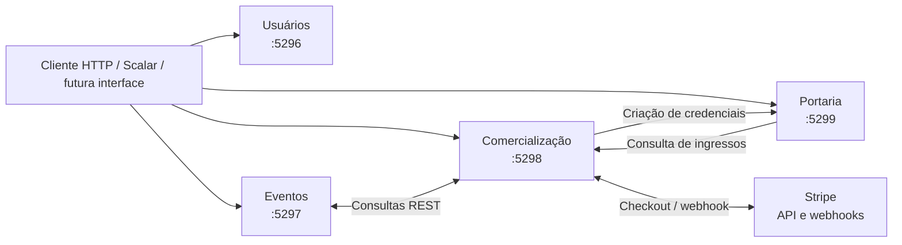
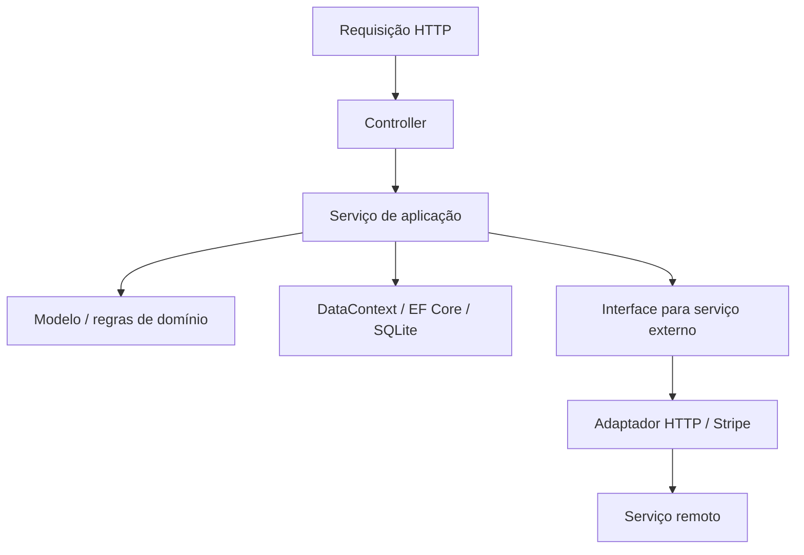
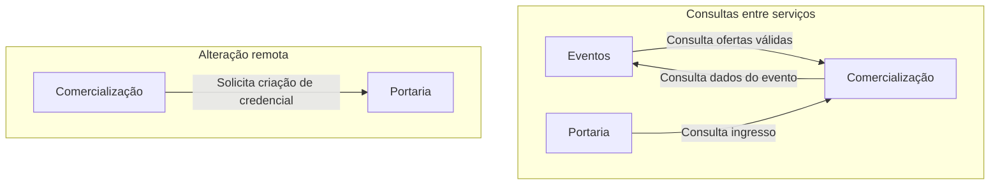
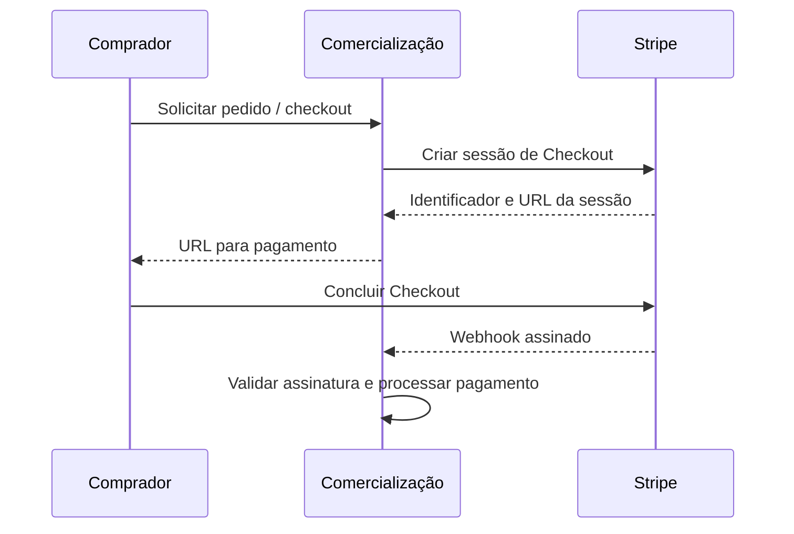
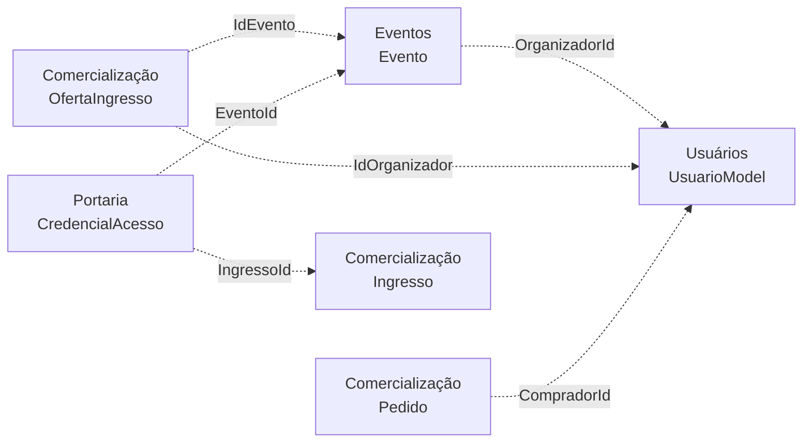
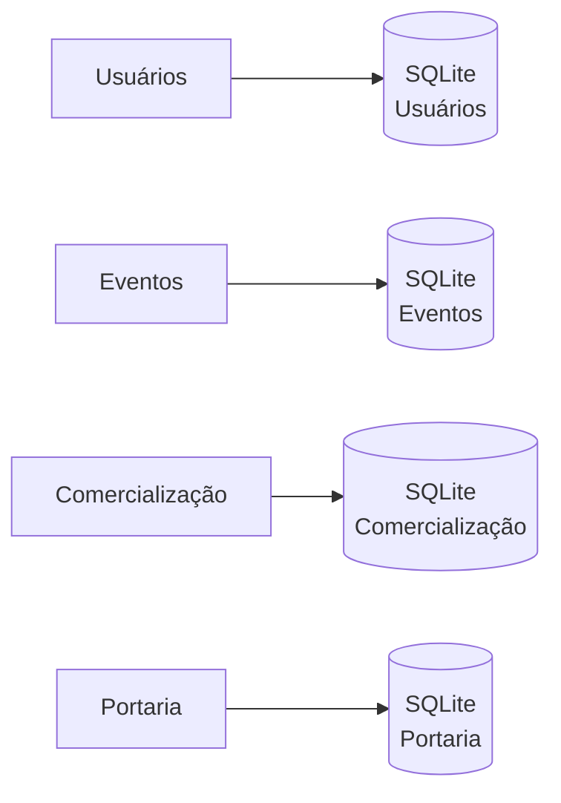
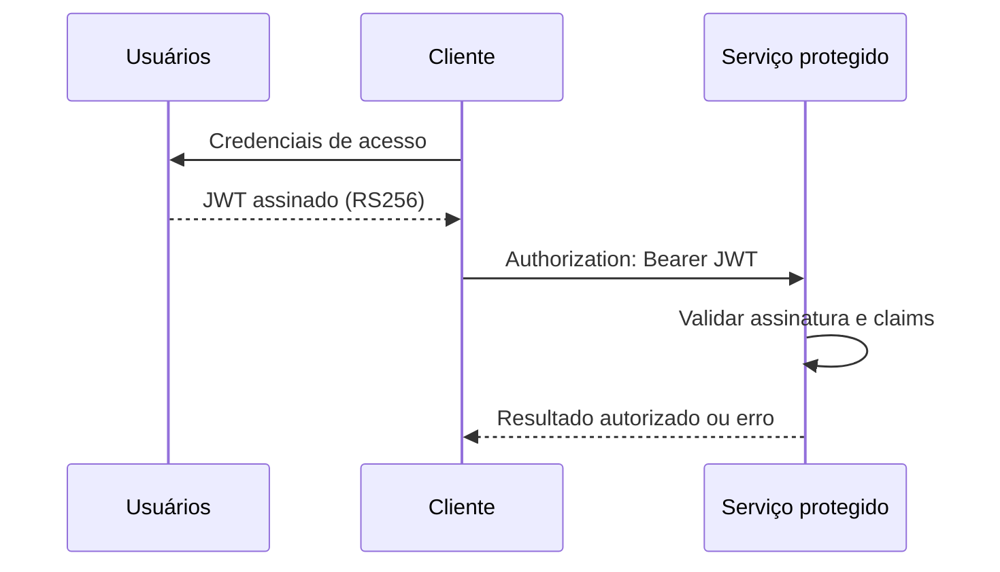
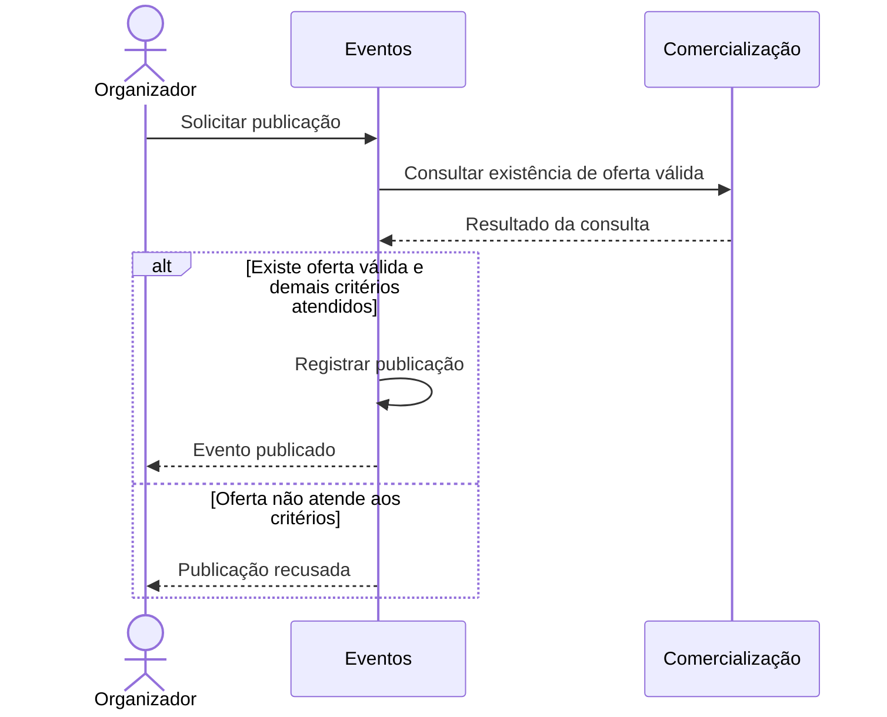
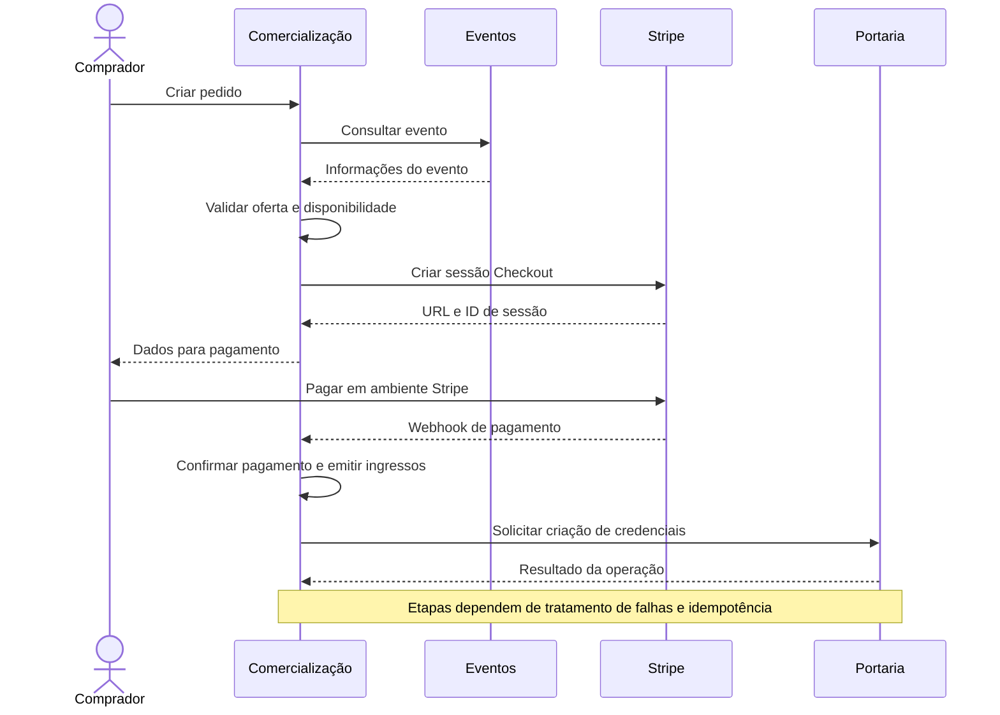
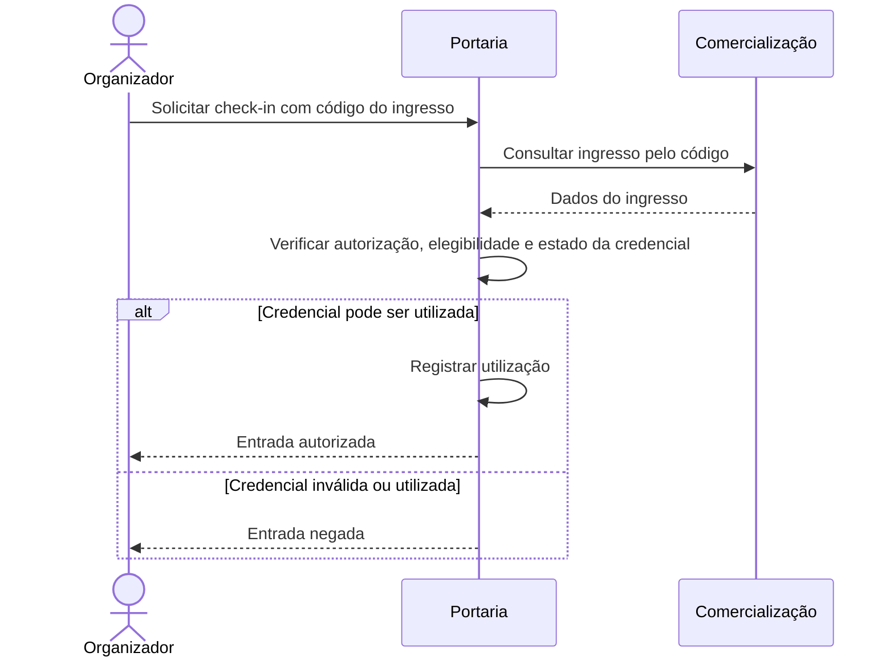

# Arquitetura do sistema

Este documento descreve a arquitetura do back-end de gerenciamento de eventos presenciais e comercialização de ingressos digitais. Apresenta os limites dos quatro microsserviços, sua organização interna, comunicação, autenticação, persistência e integração com a Stripe.

> **Escopo e precisão:** este texto documenta a organização e os fluxos identificados no código e nas configurações discutidas. Diagramas são visões lógicas simplificadas: não representam todos os endpoints nem asseguram, por si só, que todos os fluxos estejam concluídos. Para nomes exatos de rotas e contratos HTTP, consulte os controllers e DTOs de cada serviço.

## Sumário

1. [Estilo arquitetural](#1-estilo-arquitetural)
2. [Microsserviços e responsabilidades](#2-microsserviços-e-responsabilidades)
3. [Organização interna das APIs](#3-organização-interna-das-apis)
4. [Comunicação e integrações](#4-comunicação-e-integrações)
5. [Referências entre microsserviços](#5-referências-entre-microsserviços)
6. [Persistência e propriedade dos dados](#6-persistência-e-propriedade-dos-dados)
7. [Autenticação e autorização](#7-autenticação-e-autorização)
8. [Fluxos principais](#8-fluxos-principais)
9. [Consistência e tratamento de falhas](#9-consistência-e-tratamento-de-falhas)
10. [Tecnologias e decisões](#10-tecnologias-e-decisões)
11. [Limitações e evolução](#11-limitações-e-evolução)
12. [Documentação complementar](#12-documentação-complementar)

---

## 1. Estilo arquitetural

A solução utiliza **arquitetura de microsserviços**, organizada em quatro aplicações ASP.NET Core independentes. Cada aplicação possui responsabilidades de negócio próprias, configurações próprias e um banco SQLite separado. A comunicação entre serviços ocorre principalmente por **APIs REST sobre HTTP**, usando chamadas diretas.

O projeto foi concebido para cumprir os requisitos acadêmicos de quatro microsserviços, pelo menos duas integrações de leitura e uma integração que provoque alteração de dados em outro microsserviço.

As portas representam o ambiente local. **Usuários é o emissor de identidades e JWTs**, mas não é necessário consultá-lo a cada requisição autenticada: os outros serviços podem verificar a assinatura do token com a chave pública correspondente.

**Não se trata de um monólito distribuído por definição:** a intenção é estabelecer limites de domínio e propriedade dos dados. Isso não elimina acoplamentos operacionais, como dependência de disponibilidade nas chamadas HTTP síncronas.

## 2. Microsserviços e responsabilidades

| Microsserviço | Responsabilidade principal | Dados sob sua responsabilidade |
|---|---|---|
| **Usuários** | Cadastro, contas, verificação de cadastro e autenticação | Usuários, contas, solicitações de cadastro |
| **Eventos** | Cadastro, atualização, publicação e consulta de eventos | Eventos, períodos, slugs e informações de publicação |
| **Comercialização** | Ofertas, pedidos, pagamentos e emissão de ingressos | Ofertas, pedidos, pagamentos, tentativas e ingressos |
| **Portaria** | Credenciais de acesso e controle de utilização | Credenciais, estado e momento da utilização |

A separação por serviço evita que um módulo controle diretamente as tabelas de outro. Ações que dependem de informações remotas utilizam contratos de integração.

**Escopo da Portaria:** na versão documentada, o **organizador do evento** realiza a validação dos ingressos. Delegação a colaboradores ou dispositivos autorizados é uma possibilidade futura, não uma funcionalidade assumida como implementada.

## 3. Organização interna das APIs

### 3.1. Padrão adotado

Internamente, as aplicações apresentam uma **organização por responsabilidades** e uma **arquitetura em camadas**, com componentes típicos de uma API ASP.NET Core:

- **Controllers / camada HTTP:** recebem requisições e expõem endpoints REST.
- **Serviços de aplicação:** coordenam casos de uso, regras e integrações.
- **Models / entidades de domínio:** representam os dados e, em vários casos, encapsulam validações e mudanças de estado.
- **Infraestrutura:** oferece persistência via EF Core, autenticação, clientes HTTP e integrações externas.
- **DTOs e mapeadores:** definem representações trocadas nas APIs e sua conversão, quando presentes.

Em partes do projeto, as dependências externas são acessadas por **interfaces** (ports) e implementações concretas (adapters). Exemplos identificados:

| Abstração | Implementação | Responsabilidade |
|---|---|---|
| `IUsuarioAtual` | `UsuarioAtualHttp` | Obtém a identidade do usuário a partir do contexto HTTP |
| `IEventoClient` | `HttpEventoClient` | Consulta Eventos a partir de Comercialização |
| `IPortariaClient` | `HttpPortariaClient` | Comunica Comercialização com Portaria |
| `IGatewayPagamento` | `StripeGatewayPagamento` | Encapsula a integração com a Stripe |
| `IQRCodeService` | `QRCodeService` | Geração de QR Code |

> **Terminologia:** o emprego dessas interfaces e adaptadores **não comprova a adoção integral de arquitetura hexagonal (Ports and Adapters)**, Clean Architecture ou Onion Architecture. Essas classificações exigiriam verificar a direção de dependências entre projetos/camadas, os limites do domínio e o grau de isolamento das tecnologias. A descrição adequada aqui é **organização em camadas/responsabilidades com uso pontual do padrão Ports and Adapters**.

### 3.2. Fluxo interno típico

O diagrama representa **possíveis caminhos de dependência**, não uma sequência obrigatória para todos os endpoints. Em particular, cada microsserviço pode organizar suas classes em diretórios diferentes.

### 3.3. Injeção de dependências e clientes tipados

No ASP.NET Core, dependências são registradas no contêiner de DI. Comercialização, por exemplo, registra clientes HTTP tipados com `AddHttpClient<IEventoClient, HttpEventoClient>()` e `AddHttpClient<IPortariaClient, HttpPortariaClient>()`, configurando URL base, timeout e um handler para a API Key interna.

Essa abordagem evita construir `HttpClient` repetidamente nos serviços de aplicação e concentra aspectos de comunicação nas implementações de infraestrutura.

### 3.4. MediatR

Comercialização utiliza **MediatR** para notificações e tratamento de eventos **dentro do processo da aplicação**. Isso ajuda a separar responsabilidades do fluxo de pagamento e emissão, mas **não equivale a comunicação assíncrona durável entre microsserviços**.

O projeto, conforme documentado, não deve ser descrito como uma arquitetura de eventos distribuídos baseada em RabbitMQ, Kafka ou filas persistentes. As integrações entre aplicações continuam baseadas em HTTP.

## 4. Comunicação e integrações

As comunicações entre microsserviços utilizam APIs REST, com representações JSON e identificadores GUID. As operações internas relevantes são:

| Origem | Destino | Tipo | Finalidade |
|---|---|---|---|
| Eventos | Comercialização | **Consulta** | Verificar se existem ofertas válidas para publicar um evento |
| Comercialização | Eventos | **Consulta** | Obter informações do evento, incluindo dados necessários à venda |
| Comercialização | Portaria | **Alteração** | Solicitar a criação de credenciais de acesso de ingressos emitidos |
| Portaria | Comercialização | **Consulta** | Obter informações de um ingresso pelo código durante a validação |

As **duas consultas e a alteração** requeridas pelo trabalho acadêmico estão representadas pelas três primeiras linhas. A quarta é uma integração adicional identificada na implementação.

**Natureza das chamadas:** uma requisição HTTP enviada de um serviço para outro é uma integração *síncrona* do ponto de vista do cliente, mesmo quando o código C# usa `async`/`await`. Essa sintaxe não transforma a comunicação em mensageria.

**Contratos:** os nomes de interfaces (`IEventoClient`, `IPortariaClient` etc.) não determinam por si só a rota pública. Os endpoints precisos devem ser conferidos nos controllers e nas implementações HTTP, evitando documentar caminhos incorretos.

### 4.1. Integração externa com a Stripe

Comercialização utiliza `Stripe.net` para criar sessões do **Stripe Checkout**. A Stripe comunica resultados por **webhook HTTP**, recebido em Comercialização. O sistema deve validar a assinatura com `Stripe:WebhookSecret` e relacionar o evento ao pagamento/pedido correto.

O redirecionamento do navegador para `Stripe:SuccessUrl` **não é comprovação suficiente** de pagamento confirmado. A confirmação precisa ser baseada em evidência confiável do provedor, como webhook validado e o estado da transação.

## 5. Referências entre microsserviços

### 5.1. Identificadores externos não são FKs locais

Cada serviço armazena identificadores de recursos de outros serviços como valores GUID. Esses campos **não formam chaves estrangeiras SQL entre os bancos SQLite independentes**.

| Serviço que armazena | Campo | Entidade de origem |
|---|---|---|
| Eventos — `Evento` | `OrganizadorId` | Usuários — `UsuarioModel` |
| Comercialização — `OfertaIngresso` | `IdEvento` | Eventos — `Evento` |
| Comercialização — `OfertaIngresso` | `IdOrganizador` | Usuários — `UsuarioModel` |
| Comercialização — `Pedido` | `CompradorId` | Usuários — `UsuarioModel` |
| Portaria — `CredencialAcesso` | `IngressoId` | Comercialização — `Ingresso` |
| Portaria — `CredencialAcesso` | `EventoId` | Eventos — `Evento` |

**Consequências arquiteturais:**

1. Um banco não pode garantir, por FK, que o GUID remoto ainda existe.
2. A validação de existência, propriedade e elegibilidade precisa ocorrer por contratos e regras de aplicação, de acordo com cada caso de uso.
3. Se o serviço de origem estiver indisponível, uma operação dependente da consulta poderá falhar ou precisar de política de recuperação.
4. Alterações entre serviços **não participam da mesma transação SQLite**; salvar dados em Comercialização não faz rollback automático de alterações já concluídas em Portaria.

### 5.2. Separação entre modelo de dados e integração

As relações **internas** — por exemplo, `Pedido` → `Pagamento` e `Pedido` → `Ingresso` em Comercialização — pertencem à [Modelagem](Modelagem.md). As referências **entre serviços**, assim como os seus riscos de consistência, são explicadas aqui.

## 6. Persistência e propriedade dos dados

Cada microsserviço utiliza **Entity Framework Core com SQLite**, mantendo um arquivo de banco próprio no ambiente de desenvolvimento.

Não existe um banco relacional compartilhado entre os quatro serviços. A separação preserva a autonomia dos modelos, mas exige coordenação por API em operações interdependentes.

As aplicações utilizam migrations do EF Core; no fluxo local documentado, elas são aplicadas durante a inicialização. A estrutura exata das tabelas, índices e constraints deve ser conferida nos `DbContext` e nas migrations, e não inferida apenas das classes C#.

**Produção:** SQLite exige atenção à persistência do volume, concorrência, backups e características da hospedagem. A existência de `Data Source=...db` no desenvolvimento não garante persistência em ambientes com sistema de arquivos efêmero.

## 7. Autenticação e autorização

### 7.1. Autenticação do usuário — JWT RS256

O microsserviço **Usuários** emite JWTs assinados com uma **chave privada RSA**. Eventos, Comercialização e Portaria validam esses tokens com a **chave pública** correspondente, verificando assinatura, emissor, audiência e validade temporal.

Na configuração exibida de Comercialização, `MapInboundClaims = false` preserva os nomes originais dos claims e a identidade é lida de `sub`. A autorização de uma ação exige mais que um token válido: deve conferir as permissões e a propriedade dos recursos envolvidos.

### 7.2. Autenticação entre serviços — API Key

Endpoints internos selecionados utilizam **API Key**, enviada pelos clientes HTTP internos e verificada no serviço de destino. O código de Comercialização registra um `InternalApiKeyHandler` e um esquema `ApiKeyAuthenticationHandler`, com políticas separadas para JWT de usuários e API Key de serviço.

As API Keys são segredos compartilhados de aplicação, não identidades de usuários finais. Elas devem ser armazenadas externamente aos arquivos versionados e transmitidas em conexões protegidas em produção.

> JWT e API Key **têm propósitos distintos**: a primeira autentica o usuário; a segunda autentica uma chamada de integração. Uma API Key válida não deve autorizar indiscriminadamente operações de usuário.

### 7.3. Operações públicas

Consultas de eventos publicados e ofertas podem ser disponibilizadas a visitantes, conforme o endpoint e as regras de negócio. A visibilidade pública de um recurso **não implica** permissão para modificá-lo.

## 8. Fluxos principais

### 8.1. Publicação de evento

### 8.2. Compra e emissão de ingresso

Esse desenho representa o **fluxo pretendido**. A implementação de cada transição e sua confiabilidade devem ser verificadas nos serviços e handlers. Pedidos gratuitos podem seguir um caminho diferente, sem sessão Stripe.

Além disso, esse fluxo ele não cobre cenários de inconsistências, como falta de energia no meio da requisição, concorrência ou algum erro interno. Nesse projeto, ele é esperado acontecer sempre sem nenhum erro, ou seja possa ser que exista inconsistência de dados.

### 8.3. Validação de entrada

O QR Code pode transportar um identificador/código de ingresso. A **leitura física ou por câmera** depende de uma interface ou equipamento apropriado; o endpoint de check-in, isoladamente, não comprova a existência de um leitor implementado.

## 9. Consistência e tratamento de falhas

A arquitetura distribuída introduz falhas que não ocorrem dentro de uma única transação local:

| Situação | Risco | Consideração arquitetural |
|---|---|---|
| Pagamento confirmado e Portaria indisponível | Ingresso emitido sem credencial disponível | Reprocessamento seguro da emissão de credenciais |
| Webhook recebido repetidamente | Emissão duplicada ou transições incorretas | Idempotência baseada na identidade do evento/sessão/pagamento |
| Timeout após envio de credencial | Não saber se a operação remota foi concluída | Consultar estado e evitar duplicação antes de repetir |
| Duas tentativas simultâneas de check-in | Uso duplicado do mesmo ingresso | Atualização atômica condicionada ao estado da credencial |
| Consulta remota indisponível | Falha ao verificar evento ou ingresso | Tratamento explícito de indisponibilidade e timeout |
| Dados de data/hora inconsistentes | Estado incorreto do evento | Padronização de instantes e conversão de fuso |

**Não se deve afirmar que há consistência eventual garantida, retries duráveis, circuit breaker, outbox ou saga implementados** sem identificar esses mecanismos no código. São estratégias possíveis de evolução, não características automaticamente presentes por adotar microsserviços ou MediatR.

**Pendências funcionais conhecidas:** RF-11 (cancelamento de pedidos elegíveis) e RF-12 (compra sem conta) ainda não foram implementados integralmente, conforme o levantamento atual. A documentação arquitetural descreve o funcionamento atual e o comportamento previsto quando necessário.

## 10. Tecnologias e decisões

| Tecnologia / técnica | Utilização |
|---|---|
| **.NET 10 / ASP.NET Core** | Implementação das APIs |
| **REST e HTTP/JSON** | Contratos de comunicação |
| **Entity Framework Core / SQLite** | Persistência independente por serviço |
| **JWT RS256** | Autenticação de usuários e validação descentralizada |
| **API Key** | Autenticação de integrações internas selecionadas |
| **HttpClientFactory / clientes tipados** | Comunicação HTTP e configuração dos clientes |
| **MediatR** | Notificações e eventos internos de Comercialização |
| **Stripe.net / Checkout / webhooks** | Integração com pagamentos |
| **QRCoder** | Geração de QR Codes de ingressos |
| **OpenAPI / Scalar** | Documentação e exploração das APIs em desenvolvimento |

A documentação local utiliza `appsettings.json`, `appsettings.Development.json` e .NET User Secrets. Ambientes publicados devem fornecer configurações apropriadas por variáveis de ambiente ou outros mecanismos seguros.

## 11. Limitações e evolução

A separação arquitetural foi dimensionada para o escopo acadêmico e para eventos presenciais simples. Não se deve interpretar a presença de quatro serviços como prova de alta disponibilidade, escalabilidade horizontal automática ou transações distribuídas garantidas.

Possíveis evoluções, sujeitas a necessidades reais, incluem:

- Tratamento completo de cancelamento, estorno, expiração e liberação de estoque.
- Reprocessamento persistente de integrações e webhooks, com idempotência verificável.
- Autorização de colaboradores e dispositivos de check-in pelo organizador.
- Revisão de armazenamento para hospedagem com persistência e concorrência adequadas.

**Decisão documental:** a descrição detalhada de campos, entidades e relacionamentos locais pertence a `Modelagem.md`. O modelo de colaboração, referências externas, políticas de comunicação e consistência pertence a este documento.

## 12. Documentação complementar

- [Requisitos de Software](RequisitosSoftware.md) — propósito, atores e requisitos funcionais.
- [Regras de Negócio](RegrasNegocio.md) — restrições e condições de operação.
- [Modelagem de Dados](Modelagem.md) — entidades e relacionamentos internos de cada microsserviço.
- [Pré-requisitos](PreRequisitos.md) — dependências e preparação do ambiente.
- [Referência de Configurações](Configuracoes.md) — propriedades de configuração e requisitos de segurança.
- [Configuração Local](ConfiguracaoLocal/) — execução de cada microsserviço.

