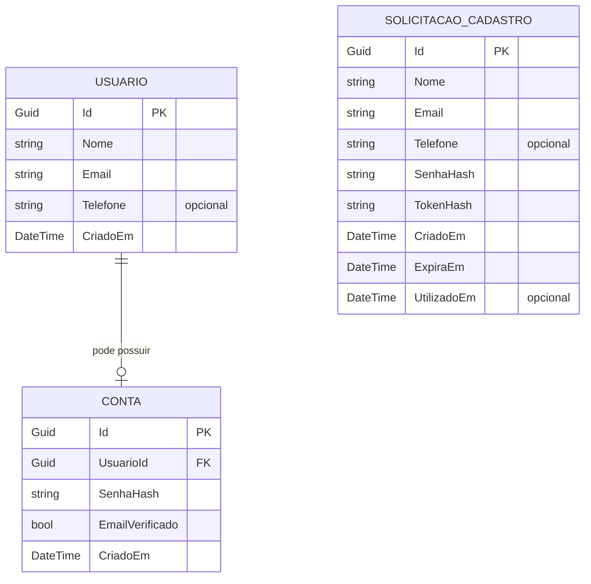
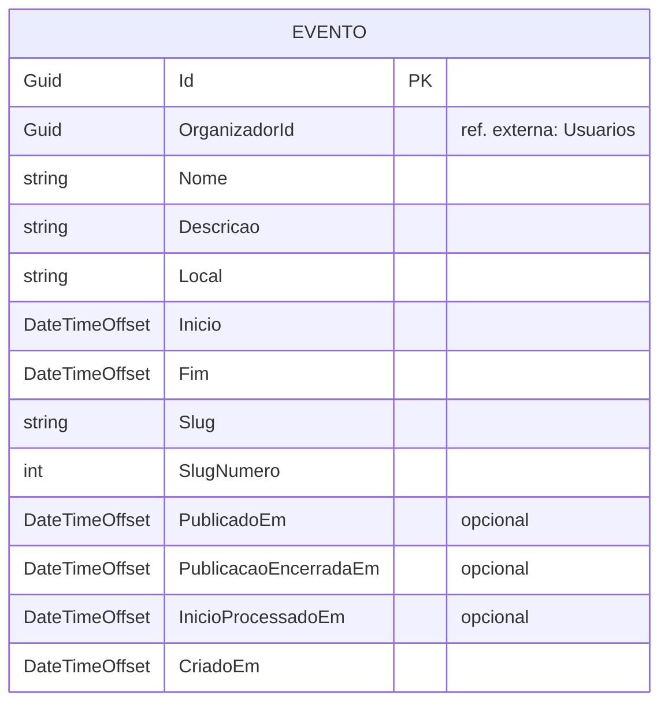
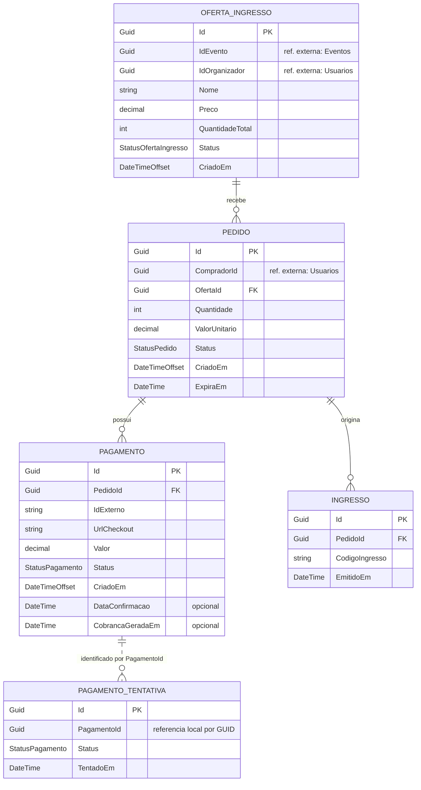
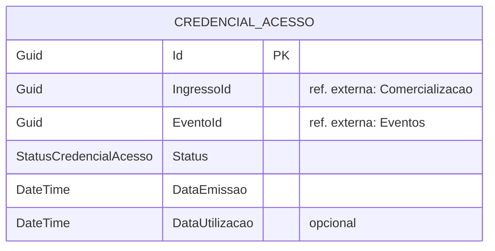

# Modelagem de dados

Este documento descreve o **modelo de domínio observado no código-fonte** dos quatro microsserviços do sistema de eventos presenciais. Cada serviço possui seu próprio modelo e armazenamento, sem relacionamentos de chave estrangeira entre bancos de microsserviços diferentes.

> **Escopo da análise:** entidades, propriedades, métodos e enumerações fornecidos para esta revisão. Os diagramas Mermaid representam **relacionamentos lógicos do modelo C#**, e não uma reprodução garantida do esquema físico do SQLite. Nomes definitivos das tabelas, tipos e restrições de colunas, índices, chaves estrangeiras e estratégias de conversão de enums devem ser conferidos nos `DbContext`, configurações do EF Core e migrations.

## Sumário

1. [Microsserviço Usuários](#1-microsserviço-usuários)

2. [Microsserviço Eventos](#2-microsserviço-eventos)

3. [Microsserviço Comercialização](#3-microsserviço-comercialização)

4. [Microsserviço Portaria](#4-microsserviço-portaria)

5. [Referências entre microsserviços](#5-referências-entre-microsserviços)

6. [Observações e pontos para revisão](#6-observações-e-pontos-para-revisão)

**---**

## 1. Microsserviço Usuários

### 1.1. Responsabilidade

Armazenar usuários, suas contas de autenticação e solicitações de cadastro ainda não concluídas.

### 1.2. Modelo de entidades

**Entidades:**

| Entidade C# | Tabela declarada | Descrição |
|---|---|---|
| `UsuarioModel` | `Usuarios` | Identidade e dados cadastrais do usuário. |
| `ContaModel` | `contas` | Credenciais de acesso e situação da verificação do e-mail. |
| `SolicitacaoCadastro` | `solicitacoes_cadastro` | Dados temporários de uma solicitação de cadastro, com token armazenado em hash e prazo de expiração. |

**Relacionamentos e observações:**

- `ContaModel.UsuarioId` referencia `UsuarioModel.Id` **dentro do mesmo microsserviço**. O código contém navegações `UsuarioModel.Conta` e `ContaModel.Usuario` e expressa a intenção de um usuário possuir zero ou uma conta. A cardinalidade e unicidade efetivamente impostas pelo banco devem ser confirmadas na configuração do EF Core.

- `SolicitacaoCadastro` não declara uma propriedade de navegação nem FK para `UsuarioModel`; não foi representada nenhuma relação persistida entre essas entidades.

- `SenhaHash` e `TokenHash` são valores derivados/armazenados; o código apresentado não revela seu algoritmo de geração.

## 2. Microsserviço Eventos

### 2.1. Responsabilidade

Armazenar os dados dos eventos, seus períodos, informações de publicação e identificadores de organizadores.

### 2.2. Modelo de entidade

**Entidade:** `Evento`. Não foram fornecidas outras entidades persistidas desse microsserviço.

**Referência entre serviços:** `OrganizadorId` armazena o identificador de um usuário mantido pelo microsserviço Usuários. **Não é uma FK local para uma tabela de Usuários.**

### 2.3. Propriedades calculadas e estados

| Elemento | Tipo | Comportamento observado |
|---|---|---|
| `SlugPublico` | Propriedade `[NotMapped]` | Retorna `Slug` quando `SlugNumero == 1`, senão `Slug-SlugNumero`. **Não é coluna.** |
| `GetStatusPublicacao()` | Método | `RASCUNHO` quando `PublicadoEm` é nulo; `PUBLICADO` quando possui valor. |
| `GetStatus()` | Método | `AGENDADO` antes de `Inicio`; `EM_ANDAMENTO` entre `Inicio` e `Fim`; `ENCERRADO` a partir de `Fim`, comparando com `DateTime.UtcNow`. |

`EnumStatusPublicacaoEvento` (`RASCUNHO`, `PUBLICADO`) e `EnumStatusEvento` (`AGENDADO`, `EM_ANDAMENTO`, `ENCERRADO`) são **estados derivados no código apresentado**, não propriedades de status persistidas.

### 2.4. Restrições expressas na entidade

- Organizador deve ter GUID diferente de `Guid.Empty`.

- Nome não pode ser vazio e deve permitir gerar um slug válido.

- Período deve ter início e fim definidos, com `Fim > Inicio`.

- `SlugNumero` deve ser pelo menos 1.

- `Publicar()` preserva o instante original de publicação em chamadas subsequentes (`PublicadoEm ??=`).

- `AtualizarInformacoes(...)` valida o período final e modifica somente os parâmetros fornecidos.

O código **não comprova** restrição de unicidade do slug no banco nem como se escolhe `SlugNumero`; isso dependerá de outras classes e do mapeamento.

## 3. Microsserviço Comercialização

### 3.1. Responsabilidade

Gerenciar ofertas de ingressos, pedidos, pagamentos, tentativas de pagamento e ingressos emitidos.

### 3.2. Modelo de entidades

**Interpretação do diagrama:** as linhas contínuas representam associações com propriedades de navegação declaradas. A linha pontilhada entre `Pagamento` e `PagamentoTentativa` indica uma **referência lógica identificada pelo GUID `PagamentoId`**, pois o código fornecido não declara navegações entre essas entidades. Não é possível confirmar a existência de uma restrição FK para ela sem examinar o `DbContext`/migrations.

### 3.3. Referências externas

| Entidade | Propriedade | Serviço proprietário |
|---|---|---|
| `OfertaIngresso` | `IdEvento` | Eventos |
| `OfertaIngresso` | `IdOrganizador` | Usuários |
| `Pedido` | `CompradorId` | Usuários |

Esses GUIDs são referências **entre microsserviços**; não representam relacionamentos relacionais entre seus bancos SQLite.

### 3.4. Estados

| Entidade | Enumeração | Valores |
|---|---|---|
| `OfertaIngresso` | `StatusOfertaIngresso` | `ATIVA`, `ESGOTADO`, `ENCERRADA` |
| `Pedido` | `StatusPedido` | `PENDENTE`, `EM_PROCESSAMENTO`, `CONFIRMADO`, `EXPIRADO`, `CANCELADO` |
| `Pagamento` | `StatusPagamento` | `PENDENTE`, `COBRANCA_GERADA`, `CONFIRMADO`, `RECUSADO`, `CANCELADO`, `ESTORNADO` |
| `PagamentoTentativa` | `StatusPagamento` | O construtor aceita somente `RECUSADO` ou `CONFIRMADO`. |

As enumerações representam os valores possíveis em C#; **o formato persistido** (texto ou número) deve ser conferido nas configurações do EF Core.

### 3.5. Propriedades calculadas e regras de domínio

**OfertaIngresso**

- `IsGratis` é calculada por `Preco == 0m`; não deve ser tratada como coluna sem mapeamento explícito.

- `Nome` não pode ser vazio; `Preco >= 0` e `QuantidadeTotal > 0`.

- `Encerrar()` impede encerramento de uma oferta já `ESGOTADO`.

- `Esgotado()` impede esgotamento de uma oferta já `ENCERRADA`.

**Pedido**

- `IsGratis` é calculada a partir de `ValorUnitario == 0m`.

- `ValorTotal()` calcula `ValorUnitario * Quantidade`; **não é uma propriedade persistida mostrada no código**.

- `Quantidade > 0` e `ValorUnitario >= 0`.

- O construtor estabelece `ExpiraEm = DateTime.UtcNow\.AddMinutes(60)`.

- `MarcarEmProcessamento()` exige pedido pendente e não expirado.

- `Confirmar()` exige pedido em processamento.

- `Cancelar()` rejeita pedido em processamento, cancelado, confirmado ou expirado.

- `Expirar(agora)` exige pedido pendente cujo prazo já terminou.

- `ComprometidosEm(agora)` considera compromissos os pedidos confirmados, em processamento ou pendentes ainda dentro do prazo. Essa expressão é utilizada como critério de seleção, não como entidade adicional.

**Pagamento**

- O construtor exige `Valor > 0`, com estado inicial `PENDENTE`.

- `RegistrarCobranca(idSessao)` exige sessão não vazia e aceita estados `PENDENTE` ou `RECUSADO`.

- `Confirmar()` exige `IdExterno` preenchido e um dos estados permitidos (`PENDENTE`, `COBRANCA_GERADA` ou `RECUSADO`); chamadas repetidas sobre `CONFIRMADO` retornam `false`.

- `Recusar()` exige estado `COBRANCA_GERADA`; se já `RECUSADO` ou `CONFIRMADO`, retorna `false`.

- `UrlCheckout` armazena uma URL associada à cobrança; `IdExterno`, o identificador externo da sessão.

**PagamentoTentativa e Ingresso**

- `PagamentoTentativa` registra o identificador do pagamento, o resultado permitido (`RECUSADO`/`CONFIRMADO`) e `TentadoEm`.

- `Ingresso` armazena `PedidoId`, `CodigoIngresso` e `EmitidoEm`. O código apresentado não permite confirmar como o código é gerado, nem a existência de índice de unicidade.

### 3.6. Ressalva sobre ingressos gratuitos

`OfertaIngresso.Preco` e `Pedido.ValorUnitario` aceitam zero, mas o construtor de `Pagamento` exige `Valor > 0`. Portanto, a modelagem permite ofertas gratuitas, enquanto a criação de um pagamento de valor zero é rejeitada. O tratamento completo dos pedidos gratuitos depende da lógica de aplicação, não fornecida nesta revisão.

## 4. Microsserviço Portaria

### 4.1. Responsabilidade

Armazenar o estado de utilização das credenciais de acesso emitidas para ingressos.

### 4.2. Modelo de entidade

**Entidade:** `CredencialAcesso`. Não foram fornecidas outras entidades persistidas desse microsserviço.

`IngressoId` e `EventoId` identificam recursos pertencentes, respectivamente, a Comercialização e Eventos. **Não são FKs locais entre bancos.**

### 4.3. Estados e validações

| Enumeração | Valores |
|---|---|
| `StatusCredencialAcesso` | `ATIVA`, `UTILIZADA`, `CANCELADA` |

- Uma nova credencial recebe `Guid.CreateVersion7()`, `Status = ATIVA` e `DataEmissao = DateTime.UtcNow`.

- `IngressoId` e `EventoId` não podem ser `Guid.Empty`.

- `DataUtilizacao` é opcional.

- Não foram apresentados métodos de domínio para utilização ou cancelamento; os fluxos de check-in e bloqueio devem ser verificados nos serviços e controladores.

- A unicidade de credencial por ingresso e a prevenção de check-in concorrente devem ser verificadas no mapeamento e nas operações de persistência.

## 5. Observações

`InicioProcessadoEm` registra o processamento/publicação do início do evento, não a confirmação do consumo em Comercialização. O pedido mantém `CompradorId` como GUID, resolvido pelo e-mail no contrato HTTP. A implantação utiliza arquivos SQLite separados em `/data`; no Render gratuito esse armazenamento é efêmero. Consulte [Implantação](Implantacao.md).

**Fonte desta versão:** classes `Evento`, `CredencialAcesso`, `Ingresso`, `OfertaIngresso`, `Pagamento`, `PagamentoTentativa`, `Pedido`, `ContaModel`, `SolicitacaoCadastro` e `UsuarioModel`, disponibilizadas para esta revisão. O documento pode ser refinado com os contextos do EF Core e as migrations para refletir também a modelagem física.
