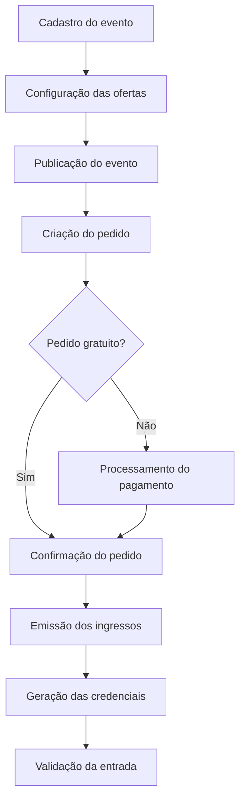
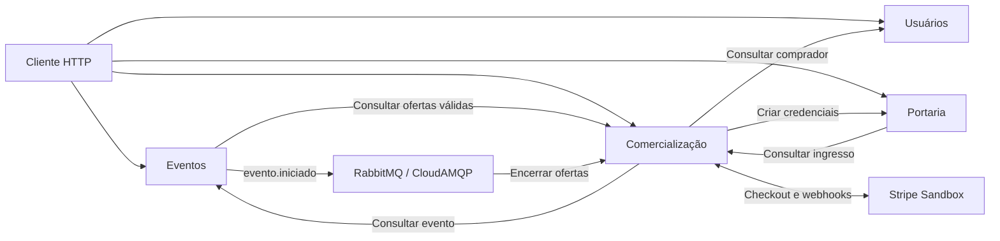
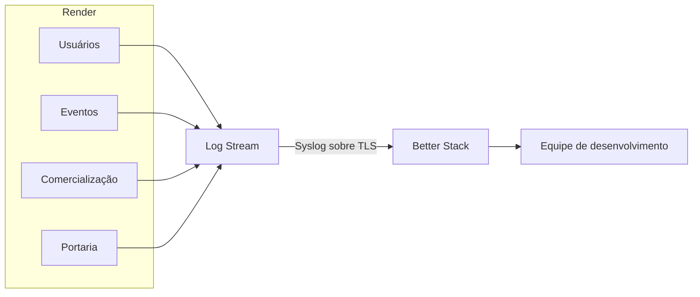

# Sistema de Eventos Presenciais

Back-end desenvolvido como projeto acadêmico para estudar arquitetura de microsserviços, integração entre APIs, comunicação assíncrona e regras de negócio aplicadas à comercialização de ingressos digitais para eventos presenciais.

## Sumário

- [Sandbox pública](#sandbox-pública)
- [Problema e objetivo](#problema-e-objetivo)
- [Funcionalidades e escopo](#funcionalidades-e-escopo)
- [Arquitetura](#arquitetura)
- [Integrações](#integrações)
- [Observabilidade](#observabilidade)
- [Documentação](#documentação)
- [Tecnologias](#tecnologias)
- [Como executar localmente](#como-executar-localmente)
- [Testes](#testes)
- [Limitações da infraestrutura](#limitações-da-infraestrutura)
- [Melhorias futuras](#melhorias-futuras)

## Sandbox pública

Os quatro microsserviços estão implantados no Render e podem ser explorados por meio das interfaces interativas do Scalar.

| Microsserviço | Documentação interativa | OpenAPI |
|---|---|---|
| Usuários | [Scalar](https://microsservicos-eventos-presenciais.onrender.com/scalar/) | [JSON](https://microsservicos-eventos-presenciais.onrender.com/openapi/v1.json) |
| Eventos | [Scalar](https://microsservicos-eventos-presenciais-hctr.onrender.com/scalar/) | [JSON](https://microsservicos-eventos-presenciais-hctr.onrender.com/openapi/v1.json) |
| Comercialização | [Scalar](https://comercializacao.onrender.com/scalar/) | [JSON](https://comercializacao.onrender.com/openapi/v1.json) |
| Portaria | [Scalar](https://portaria-gdve.onrender.com/scalar/) | [JSON](https://portaria-gdve.onrender.com/openapi/v1.json) |

As informações de acesso destinadas à demonstração acadêmica são disponibilizadas na release correspondente.

**Atenção:** o ambiente destina-se exclusivamente à demonstração e aos testes. Não utilize dados pessoais ou meios de pagamento reais.

## Problema e objetivo

A comercialização manual de ingressos pode depender de atendimento individual, planilhas, conferência de pagamentos e validação presencial de participantes.

Esses procedimentos podem dificultar:

- O acompanhamento de pedidos e pagamentos.
- O controle da disponibilidade de ingressos.
- A emissão e recuperação dos ingressos adquiridos.
- A prevenção de utilizações repetidas.
- A divulgação das informações dos eventos.

O objetivo é desenvolver uma solução que automatize o fluxo de comercialização de ingressos digitais, desde o cadastro e a publicação do evento até o controle de entrada dos participantes.

### Público-alvo

Pequenos organizadores de apresentações musicais, palestras, espetáculos teatrais, encontros culturais e outros eventos presenciais que necessitam de uma solução simples de comercialização e controle de acesso.

Os problemas apresentados correspondem à análise inicial do domínio e não foram validados por pesquisas de mercado.

## Funcionalidades e escopo

### Funcionalidades

| Domínio | Funcionalidades |
|---|---|
| Usuários | Cadastro com ou sem conta de acesso, verificação de e-mail, autenticação e gerenciamento cadastral. |
| Eventos | Cadastro, atualização, publicação, consulta e compartilhamento de eventos. |
| Comercialização | Gerenciamento de ofertas, controle de disponibilidade, criação e cancelamento de pedidos elegíveis, processamento de pagamentos, emissão de ingressos e QR Codes. |
| Portaria | Geração de credenciais de acesso, validação de ingressos e registro de entrada. |

O catálogo de funcionalidades e suas respectivas restrições encontra-se nos documentos de Requisitos de Software e Regras de Negócio.

### Fluxo principal



### Cancelamento e estorno

O cancelamento está restrito aos pedidos pendentes de pagamento que atendam às regras de negócio estabelecidas.

Para esta versão acadêmica, foi definida temporariamente a RN-37, segundo a qual pagamentos confirmados não podem ser estornados pelo sistema.

A existência do estado `ESTORNADO` no modelo de pagamentos representa uma preparação para futuras implementações.

Pedidos gratuitos não exigem transações financeiras para a emissão dos ingressos.

### Portaria e bloqueio de credenciais

A validação dos ingressos é responsabilidade do organizador do evento.

Como a emissão de ingressos ocorre somente após a confirmação do pagamento ou a confirmação de um pedido gratuito, e pedidos confirmados não podem ser cancelados nesta versão, o sistema não contempla o bloqueio de credenciais já emitidas.

A revogação de credenciais e a delegação da validação a colaboradores ou dispositivos autorizados constituem possibilidades de evolução.

### Segurança dos pedidos

Para facilitar a demonstração acadêmica, foram simplificados os mecanismos de autorização das operações relacionadas a pedidos e ingressos.

O comprador pode realizar pedidos sem possuir uma conta de acesso, utilizando seu endereço de e-mail para identificação cadastral.

Essa identificação não comprova a titularidade do e-mail e não constitui um mecanismo de autenticação.

As rotas de consulta e gerenciamento de pedidos e ingressos não possuem proteção completa nesta versão. Sua utilização em um ambiente comercial exige mecanismos adequados de autenticação e autorização.

## Arquitetura

A aplicação é composta por quatro microsserviços ASP.NET Core, com bancos SQLite independentes e comunicação síncrona por HTTP REST e assíncrona por RabbitMQ.

| Microsserviço | Responsabilidade | Porta local |
|---|---|---:|
| Usuários | Cadastro, contas e autenticação. | 5296 |
| Eventos | Gerenciamento e publicação de eventos. | 5297 |
| Comercialização | Ofertas, pedidos, pagamentos e ingressos. | 5298 |
| Portaria | Credenciais de acesso e check-in. | 5299 |



Cada microsserviço é responsável por seu próprio banco de dados. Identificadores externos, como `OrganizadorId`, `EventoId` e `IngressoId`, são referências por GUID, e não chaves estrangeiras entre bancos distintos.

Internamente, os serviços são organizados em controllers, serviços, entidades de domínio e componentes de infraestrutura, utilizando interfaces e adaptadores pontualmente para abstrair dependências externas.

O projeto não representa uma implementação integral de arquitetura hexagonal.

## Integrações

O trabalho acadêmico exige pelo menos duas consultas entre microsserviços e uma alteração de dados solicitada por outro serviço.

| Origem | Destino | Comunicação | Finalidade |
|---|---|---|---|
| Eventos | Comercialização | HTTP — Consulta | Verificar a existência de ofertas válidas antes da publicação. |
| Comercialização | Eventos | HTTP — Consulta | Consultar o estado, período e organizador do evento. |
| Comercialização | Usuários | HTTP — Consulta | Identificar o comprador pelo e-mail. |
| Comercialização | Portaria | HTTP — Alteração | Solicitar a criação das credenciais de acesso. |
| Portaria | Comercialização | HTTP — Consulta | Consultar informações do ingresso durante a validação. |
| Eventos | Comercialização | AMQP — Notificação | Comunicar o início do evento para encerramento das ofertas ativas. |

A integração com a Stripe utiliza sessões de Checkout e webhooks assinados. O redirecionamento do navegador, isoladamente, não comprova a confirmação do pagamento.

O MediatR é utilizado para notificações internas em Comercialização.

## Observabilidade

Os microsserviços implantados no Render utilizam o Better Stack para centralização e consulta de logs.

A integração utiliza o mecanismo nativo de Log Streams do Render, encaminhando os logs por Syslog sobre TLS, sem necessidade de agentes adicionais ou alterações no código-fonte.



A centralização permite acompanhar os logs em tempo real, investigar falhas de integração e auxiliar nos testes do ambiente remoto.

O acesso ao painel é restrito aos integrantes autorizados da equipe, sem necessidade de acesso administrativo ao Render.

## Documentação

| Documento | Conteúdo |
|---|---|
| Requisitos de Software | Atores e requisitos funcionais organizados por domínio. |
| Regras de Negócio | Condições, restrições e invariantes do domínio. |
| Arquitetura | Estrutura, integrações, segurança e decisões arquiteturais. |
| Modelagem | Entidades e relacionamentos internos. |
| Pré-requisitos | Dependências e preparação do ambiente. |
| Configurações | Referência das propriedades de configuração. |
| Configuração local | Procedimentos de execução dos microsserviços. |
| Implantação | Infraestrutura remota e procedimentos de implantação. |
| OpenAPI / Scalar | Contratos técnicos e exploração das APIs REST. |

Os requisitos funcionais e as regras de negócio possuem identificadores únicos utilizados para rastreabilidade com as operações das APIs.

## Tecnologias

| Tecnologia | Utilização |
|---|---|
| C# / .NET 10 / ASP.NET Core | Desenvolvimento das APIs. |
| HTTP REST / JSON | Comunicação síncrona. |
| Entity Framework Core / SQLite | Persistência e migrations. |
| JWT RS256 / RSA | Autenticação de usuários. |
| API Key | Autenticação de chamadas internas selecionadas. |
| Stripe.net / Stripe Checkout | Processamento de pagamentos. |
| Stripe Webhooks / Stripe CLI | Notificações de pagamentos e testes locais. |
| MediatR | Notificações internas. |
| QRCoder | Geração de QR Codes. |
| OpenAPI / Scalar | Documentação das APIs. |
| xUnit | Testes automatizados. |
| RabbitMQ / AMQP | Comunicação assíncrona. |
| BackgroundService | Processamento em segundo plano. |
| Docker / Docker Compose | Conteinerização e infraestrutura local. |
| Render / CloudAMQP | Hospedagem remota. |
| Better Stack / Syslog TLS | Centralização de logs. |

## Como executar localmente

### 1. Pré-requisitos

- .NET SDK 10.
- Git.
- OpenSSL.
- Docker e Docker Compose.
- RabbitMQ.
- Credenciais de teste da Stripe.
- Stripe CLI.

Consulte a documentação de Pré-requisitos para preparar as dependências e gerar o par de chaves RSA.

### 2. Clone o repositório

```bash
git clone <URL_DO_REPOSITORIO>
cd microsservicos-eventos-presenciais
```

### 3. Configure os microsserviços

Siga os respectivos guias de configuração local.

Os arquivos `appsettings.Development.json` contêm as configurações de desenvolvimento, enquanto informações sensíveis são definidas por meio de .NET User Secrets.

| Microsserviço | Endereço local |
|---|---|
| Usuários | http://localhost:5296 |
| Eventos | http://localhost:5297 |
| Comercialização | http://localhost:5298 |
| Portaria | http://localhost:5299 |

### 4. Inicie o RabbitMQ

Na raiz do repositório:

```bash
docker compose up -d rabbitmq
```

### 5. Inicie os microsserviços

Ordem recomendada:

1. Usuários.
2. Portaria.
3. Comercialização.
4. Eventos.

Execute em terminais separados, no diretório `Api` de cada serviço:

```bash
dotnet restore
dotnet run
```

### 6. Configure os webhooks da Stripe

```bash
stripe listen --forward-to http://localhost:5298/api/webhooks/pagamentos
```

Configure o segredo de assinatura conforme o guia de Comercialização.

### 7. Explore as APIs

As interfaces do Scalar podem ser acessadas pelo caminho `/scalar/`, conforme a configuração de cada serviço.

Os contratos OpenAPI estão disponíveis no caminho `/openapi/v1.json`.

**Segurança:** nunca versione chaves privadas RSA, tokens, credenciais de serviços externos, segredos de webhooks ou arquivos contendo informações sensíveis.

## Testes

Para executar os testes automatizados, acesse o diretório do projeto de testes ou da solução correspondente:

```bash
dotnet test
```

A validação também deve considerar os fluxos de integração entre os serviços, especialmente publicação de eventos, disponibilidade de ingressos, cancelamento de pedidos, confirmação de pagamentos, emissão de ingressos e check-in.

Os logs centralizados auxiliam no diagnóstico durante os testes remotos.

## Limitações da infraestrutura

A infraestrutura gratuita utilizada na sandbox apresenta limitações como:

- Suspensão dos serviços por inatividade e cold start.
- Armazenamento efêmero dos bancos SQLite.
- Limites de processamento, transferência e retenção de logs.
- Possíveis interrupções de processos em segundo plano.
- Atrasos no processamento de mensagens e webhooks.

O envio real de e-mails permanece uma limitação enquanto for utilizado o `FakeEmailSender`.

Operações distribuídas, como o cancelamento de cobranças externas e a persistência local, não participam de uma única transação atômica.

Não existem garantias de disponibilidade contínua, durabilidade dos dados ou processamento exatamente uma vez.

## Melhorias futuras

### 1. Estorno de pagamentos

Permitir estornos totais ou parciais, conforme as condições de elegibilidade e os meios de pagamento utilizados.

Essa evolução exigirá a revisão da RN-37 e a definição dos efeitos sobre pedidos, ingressos, credenciais e disponibilidade.

### 2. Abstração e modelagem de pagamentos

Aprimorar a interface do gateway de pagamentos e o modelo de persistência para contemplar:

- Diferentes provedores e meios de pagamento.
- Múltiplas moedas e cotações cambiais.
- Registro das taxas de conversão utilizadas nas transações.
- Taxas dos provedores e informações de estorno.

### 3. Bloqueio de credenciais de acesso

Permitir o bloqueio manual de credenciais pelo organizador e sua invalidação automática após cancelamentos ou estornos elegíveis.

A evolução deverá preservar a consistência entre Comercialização e Portaria.

### 4. Cancelamento de pedidos gratuitos

Estabelecer condições para o cancelamento de pedidos gratuitos confirmados, considerando a invalidação dos ingressos, o bloqueio das credenciais e a liberação da quantidade comprometida.

### 5. Localização e fuso horário

Adicionar informações estruturadas de localização aos eventos, incluindo o identificador de fuso horário da região em que serão realizados.

Os horários deverão ser interpretados conforme a localização do evento, evitando divergências relacionadas ao fuso horário do servidor.

A comunicação entre microsserviços deverá utilizar UTC ou valores com deslocamento explícito.

### 6. Notificações por e-mail

Implementar o envio de e-mails para confirmação de pedidos, pagamentos, disponibilização de ingressos e acompanhamento das compras.

Também deverá ser considerada a verificação da titularidade do e-mail utilizado por compradores sem conta.

### 7. Segurança e acompanhamento de pedidos

Proteger as rotas de pedidos e ingressos mediante mecanismos adequados de autorização.

Para compradores autenticados, o acesso deverá considerar a identidade e a titularidade do pedido.

Para compradores sem conta, poderão ser utilizados links privados enviados ao endereço de e-mail verificado, contendo tokens aleatórios e imprevisíveis, como UUIDv4 gerados de forma segura.

Os identificadores internos UUIDv7 poderão ser preservados, mantendo separadas a identificação dos recursos e a autorização de acesso.

Os tokens deverão possuir prazo de validade, armazenamento seguro e possibilidade de revogação.

A posse do link constituirá uma credencial de acesso, não devendo ser confundida com a comprovação da identidade do comprador.

### 8. Comprovantes após o evento

Após o encerramento do evento, disponibilizar e encaminhar por e-mail um documento PDF contendo as informações do pedido e da compra realizada.

Quando houver registro de entrada, poderá ser emitido também um comprovante de participação.

Após o período de acompanhamento, os links privados de acesso aos pedidos deverão expirar ou ser revogados.

### 9. Delegação de responsabilidades na Portaria

Permitir que organizadores autorizem colaboradores e dispositivos a validar ingressos de eventos específicos, sem compartilhar suas credenciais pessoais.

### 10. Resiliência e consistência distribuída

Aprimorar a recuperação de falhas e a consistência entre microsserviços mediante:

- Retry, timeout e circuit breaker.
- Idempotência e deduplicação de mensagens.
- Transactional Outbox.
- Dead-letter queues.
- Reconciliação de pagamentos e pedidos.
- Transações compensatórias.

### 11. Infraestrutura e observabilidade

Evoluir a infraestrutura para contemplar bancos persistentes, backups automatizados, métricas, rastreamento distribuído, identificadores de correlação, alertas, rate limiting e pipelines de CI/CD.