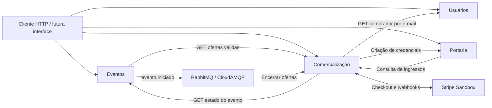

# Sistema de Eventos Presenciais

Back-end desenvolvido como projeto acadêmico para estudar **arquitetura de microsserviços**, integração entre APIs e regras de negócio aplicadas à **comercialização de ingressos digitais para eventos presenciais**.

A solução é voltada, inicialmente, a pequenos organizadores de apresentações musicais, palestras, espetáculos e outros eventos que precisam organizar vendas e controlar a entrada de participantes.

## Sumário

- [Sandbox pública](#sandbox-pública)
- [Problema e objetivo](#problema-e-objetivo)

- [Funcionalidades e escopo](#funcionalidades-e-escopo)

- [Arquitetura](#arquitetura)

- [Documentação](#documentação)

- [Integrações entre microsserviços](#integrações-entre-microsserviços)

- [Tecnologias](#tecnologias)

- [Como executar localmente](#como-executar-localmente)

- [Testes](#testes)


- [Limitações e evolução](#limitações-e-evolução)

## Microsserviço com Sandbox pública

Os quatro serviços estão implantados no Render.

| Microsserviço | API pública | Acesso informado na release |
|---|---|---|
| Usuários | [Usuários](https://microsservicos-eventos-presenciais.onrender.com) | [Abrir](https://microsservicos-eventos-presenciais.onrender.com/scalar/) |
| Eventos | [Eventos](https://microsservicos-eventos-presenciais-hctr.onrender.com) | [Abrir](https://microsservicos-eventos-presenciais-hctr.onrender.com/scalar) |
| Comercialização | [Comercialização](https://comercializacao.onrender.com) | [Abrir](https://comercializacao.onrender.com) |
| Portaria | [Portaria](https://portaria-gdve.onrender.com) | [Abrir](https://portaria-gdve.onrender.com) |

Para mais informação consulte [Implantação](Docs/Implantacao.md).

## Problema e objetivo

A venda manual de ingressos pode depender de atendimento individual, registros em planilhas, conferência de pagamentos e validação presencial sem controle centralizado. Isso pode dificultar o acompanhamento da disponibilidade, a emissão dos ingressos e a prevenção de utilizações repetidas. O principal foco seria na criação de eventos simples para casos mais simples, diminuindo a burocracia presente em grandes plataformas.

O objetivo deste projeto é **implementar o back-end de um fluxo de venda e utilização de ingressos digitais**, desde o cadastro e a publicação de eventos até o pagamento, a emissão do ingresso e o controle de entrada.

O problema foi identificado durante a análise inicial do domínio; **as hipóteses de mercado ainda não foram validadas por pesquisa com usuários**.

## Funcionalidades e escopo

O sistema foi projetado para atender aos seguintes fluxos:

- **Usuários:** cadastro com ou sem conta, autenticação e gerenciamento cadastral. O envio real de e-mails permanece pendente (FakeEmailSender).

- **Eventos:** cadastro, atualização, publicação, consulta e compartilhamento de eventos por endereço público.

- **Comercialização:** criação e consulta de ofertas, pedidos por e-mail sem conta, encerramento automático de ofertas, processamento de pagamentos via Stripe Checkout e emissão de ingressos digitais.

- **Portaria:** criação de credenciais de acesso, validação de ingressos e registro de utilização para evitar entradas repetidas.

**Na versão atual, a validação dos ingressos é responsabilidade do organizador do evento.** A delegação desse trabalho a colaboradores ou dispositivos autorizados é uma possibilidade de evolução.

O catálogo completo de funcionalidades, inclusive as planejadas, está em [Requisitos de Software](Docs/RequisitosSoftware.md). As restrições do domínio estão em [Regras de Negócio](Docs/RegrasNegocio.md).

## Arquitetura

A aplicação é composta por **quatro microsserviços ASP.NET Core**, com **bancos SQLite independentes** e comunicação síncrona por HTTP REST e assíncrona por RabbitMQ (AMQP).

| Microsserviço | Responsabilidade | Porta local |
|---|---|---|
| **Usuários** | Contas, cadastro, autenticação e emissão de JWTs | `5296` |
| **Eventos** | Gerenciamento e publicação de eventos presenciais | `5297` |
| **Comercialização** | Ofertas, pedidos, pagamentos e ingressos | `5298` |
| **Portaria** | Credenciais de acesso e check-in | `5299` |



Cada serviço é responsável pelo próprio banco de dados. Identificadores de recursos externos, como `OrganizadorId`, `EventoId` e `IngressoId`, são **referências por GUID**, e não chaves estrangeiras entre bancos de microsserviços.

Internamente, os serviços utilizam uma **organização por responsabilidades** (controllers, serviços, entidades e infraestrutura), com uso pontual de interfaces e adaptadores para dependências externas. **O projeto não é apresentado como uma implementação integral de arquitetura hexagonal.**

A descrição detalhada, incluindo autenticação, contratos de comunicação, fluxos e consistência distribuída, está em [Arquitetura](Docs/Arquitetura.md). As entidades e seus relacionamentos internos estão em [Modelagem](Docs/Modelagem.md).

## Documentação

| Documento | Conteúdo |
|---|---|
| [Requisitos de Software](Docs/RequisitosSoftware.md) | Propósito, atores, escopo e requisitos funcionais RF-01 a RF-24 |
| [Regras de Negócio](Docs/RegrasNegocio.md) | Restrições de domínio e rastreabilidade com os requisitos |
| [Arquitetura](Docs/Arquitetura.md) | Microsserviços, integrações, segurança e decisões arquiteturais |
| [Modelagem](Docs/Modelagem.md) | Entidades e relacionamentos internos de cada microsserviço |
| [Pré-requisitos](Docs/PreRequisitos.md) | Ferramentas, dependências e geração de chaves RSA |
| [Configurações](Docs/Configuracoes.md) | Referência das propriedades de configuração |
| [Configuração local](Docs/ConfiguracaoLocal/) | Instruções individuais para preparar e executar os serviços |
| [Implantação](Docs/Implantacao.md) | Sandbox remota, variáveis, infraestrutura e diagnóstico |


## Integrações entre microsserviços

O trabalho acadêmico exige **pelo menos duas consultas entre serviços e uma alteração de dados solicitada por outro serviço**. O projeto contempla as seguintes integrações principais:

| Origem | Destino | Tipo | Objetivo |
|---|---|---|---|
| Eventos | Comercialização | **Consulta** | Verificar se o evento possui oferta válida antes da publicação |
| Comercialização | Eventos | **Consulta** | Verificar estado AGENDADO na criação de ofertas e pedidos; validar propriedade/publicação conforme operação |
| Comercialização | Portaria | **Alteração** | Solicitar a criação das credenciais dos ingressos emitidos |
| Comercialização | Usuários | Consulta HTTP | Identificar comprador previamente cadastrado por e-mail |
| Portaria | Comercialização | Consulta HTTP | Consultar ingresso durante validação |
| Eventos | Comercialização | Notificação AMQP | Encerrar ofertas ativas ao iniciar evento |

A integração com a **Stripe** ocorre por meio da criação de sessões de Checkout e do recebimento de webhooks assinados. O redirecionamento do navegador após o Checkout, isoladamente, **não comprova a confirmação do pagamento**.

> **Nota:** o MediatR é utilizado para notificações internas em Comercialização.

## Tecnologias

| Tecnologia | Utilização |
|---|---|
| **C# / .NET 10 / ASP.NET Core** | Implementação das APIs |
| **HTTP REST / JSON** | Integração entre microsserviços |
| **Entity Framework Core 10** | Persistência e migrations |
| **SQLite** | Banco de dados independente por serviço |
| **JWT RS256** | Autenticação de usuários e validação com chaves RSA |
| **API Key** | Autenticação de chamadas internas selecionadas |
| **Stripe.net / Stripe Checkout** | Criação e acompanhamento de pagamentos |
| **Stripe Webhooks / Stripe CLI** | Confirmação de pagamentos e testes locais |
| **MediatR** | Notificações e tratamento de eventos dentro de Comercialização |
| **QRCoder** | Geração de QR Codes dos ingressos |
| **OpenAPI / Scalar** | Documentação e exploração das APIs |
| **xUnit** | Testes automatizados nos projetos que os possuem |
| RabbitMQ / AMQP / RabbitMQ.Client | Mensageria entre Eventos e Comercialização |
| BackgroundService | Detecção periódica e consumo de mensagens |
| Docker / Docker Compose | Imagens dos serviços e broker local |
| Render / CloudAMQP | Hospedagem remota gratuita |

## Como executar localmente

O ambiente de desenvolvimento requer **.NET SDK 10, Git, OpenSSL e RabbitMQ (Docker Compose recomendado)**, além das credenciais de teste da Stripe para executar o fluxo de pagamentos.

**1. Clone o repositório:**

```bash
git clone <URL_DO_REPOSITORIO>
cd microsservicos-eventos-presenciais
```

**2. Prepare os recursos compartilhados:** siga o documento [Pré-requisitos](Docs/PreRequisitos.md), que explica a geração do par de chaves RSA e as dependências do ambiente.

**3. Configure cada microsserviço:** os arquivos `appsettings.Development.json` contêm endereços e conexões locais; os segredos são definidos via **.NET User Secrets**. Siga os guias abaixo:

| Serviço | Guia local | Endereço de referência |
|---|---|---|
| Usuários | [Configuração de Usuários](Docs/ConfiguracaoLocal/Usuario.md) | `http://localhost:5296` |
| Eventos | [Configuração de Eventos](Docs/ConfiguracaoLocal/Eventos.md) | `http://localhost:5297` |
| Comercialização | [Configuração de Comercialização](Docs/ConfiguracaoLocal/Comercializacao.md) | `http://localhost:5298` |
| Portaria | [Configuração de Portaria](Docs/ConfiguracaoLocal/Portaria.md) | `http://localhost:5299` |

**4. Inicie o RabbitMQ na raiz do repositório:**

```bash
docker compose up -d rabbitmq
```

Inicie Usuários, Portaria, Comercialização e Eventos, nessa ordem recomendada (Comercialização declara a fila antes do produtor).

**Execute cada aplicação em seu próprio terminal**, na pasta `Api` correspondente:

```bash
dotnet restore
dotnet run
```

**5. Para testar pagamentos**, inicie o listener do Stripe CLI seguindo o [guia de Comercialização](Docs/ConfiguracaoLocal/Comercializacao.md). Aquele documento explica o segredo `whsec_`, o encaminhamento para `/api/webhooks/pagamentos` e os comandos de inspeção e simulação de eventos.

As interfaces Scalar ficam disponíveis, em ambiente de desenvolvimento, no caminho `/scalar/v1` de cada API, conforme suas configurações de inicialização.

**Segurança:** nunca versione `private.pem`, chaves de API, segredos de webhook ou arquivos locais de User Secrets. As configurações de desenvolvimento não devem ser reutilizadas como credenciais de produção.

## Testes

Os projetos de testes utilizam as dependências declaradas nos respectivos arquivos `.csproj`. Para executar os testes existentes, acesse o diretório do projeto de testes ou da solução correspondente e utilize:

```bash
dotnet test
```

Os testes automatizados não substituem os testes de integração entre os quatro serviços, especialmente os fluxos de pagamento, emissão de ingressos e check-in.

## Limitações e evolução

O ambiente gratuito possui suspensão por inatividade, cold start, franquias e armazenamento efêmero. Os bancos SQLite podem ser perdidos durante reinicializações. O processamento em segundo plano não é contínuo e webhooks podem atrasar. Não use dados pessoais reais. A validação remota completa, o RF-11, envio real de e-mails, rate limiting e melhorias de resiliência permanecem pendentes ou em avaliação. Não há garantia de disponibilidade, transações distribuídas ou processamento exatamente uma vez.
